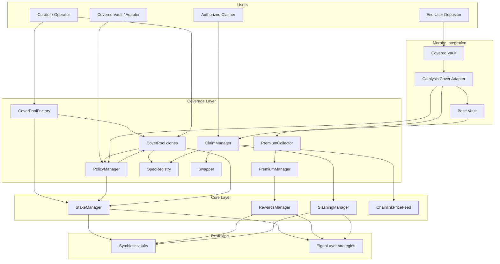

# Coverage System Overview

## Introduction

Catalysis Coverage is the application layer that turns restaked collateral into programmable protection.
It sits on top of Catalysis Core, which abstracts Symbiotic and EigenLayer operations such as committee
creation, stake tracking, reward distribution, and slashing.

Coverage contracts manage:

- pool creation and underwriting policy terms,
- policy request and binding lifecycle,
- premium collection and fee routing, and
- claim adjudication and payout settlement.

Core contracts manage:

- committee capacity and stake accounting,
- operator and vault connectivity to restaking platforms,
- reward fan-out to restaking adapters, and
- slashing execution and collateral return.

## Terminology and Mapping

Coverage and Core share a canonical identifier:

- `policyId` (Coverage) is the same value as `committeeId` (Core).
- committee-level capacity in Core is set from requested `coverageAmount`.
- slashing is executed by committee, which means per policy.

Coverage request actor mapping:

- The `buyer` field in policy metadata is typically the covered vault itself or its adapter/agent contract.
- The `claimer` is a separately authorized address that can file claims for that policy.
- In adapter-based integrations, `claimer` is typically the cover adapter.
- In atomic shortfall make-whole flows, `beneficiary` is typically the cover adapter so it can top up the exit path.

This 1:1 mapping keeps capacity, accounting, and loss handling aligned across layers.

## High-Level Architecture

## Dual Vault Integration Model

For Morpho-style integrations, the insured product uses a dual-vault topology:

- **Covered Vault (Morpho V2)**: user-facing insured vault.
- **Catalysis Cover Adapter**: strategy adapter that allocates to base vault and handles shortfall claims.
- **Base Vault (Morpho V1/V2)**: underlying yield vault.

Behavioral split:

- deposits into **Covered Vault** are premium-bearing and insured,
- deposits into **Base Vault** are not insured by Coverage.

Each covered vault maps to one base vault for deterministic accounting and claim attribution.

## Key Design Principles

### 1) Pool-Scoped Underwriting

Each `CoverPool` is curator-controlled and has:

- its own quote signer (`QUOTE_SIGNER_ROLE`),
- independent fee settings (`poolFeeBps`, `feeRecipient`), and
- policy binding authority via pool admin role.

This isolates underwriting strategy and economics across pools.

### 2) Draft-to-Bound Policy Lifecycle

Policies are requested first, then bound later:

1. `PolicyManager.requestCoverage()` creates a draft and committee.
2. Curator binds via `CoverPool.bindPolicyForRequest(...)` once delegation is ready.
3. `PolicyManager.bindPolicy(...)` stores immutable-like policy metadata for claims.

### 3) Core-Mediated Economic Security

Coverage does not slash or distribute rewards directly on restaking protocols.
Instead, Coverage calls Core:

- premium reward routing: `PremiumManager -> RewardsManager`,
- claim-driven slashing: `ClaimManager -> SlashingManager`.

This keeps SSP-specific complexity in Core adapters.

### 4) Parametric Claim Evaluation

Claim logic is delegated to registered `ISpec` implementations:

- pool registers `(pool, specId) -> spec` in `SpecRegistry` at bind time,
- claim path resolves spec from registry and runs `spec.evaluate(context)`.

## End-to-End Flow Summary

1. Curator creates a pool through `CoverPoolFactory`.
2. Factory registers curator/operator to network via Core `StakeManager`.
3. Covered vault (or its adapter acting as buyer) requests coverage through `PolicyManager` (draft created).
4. Core committee is created with `committeeId = policyId`; operator assigned.
5. Restakers delegate stake in supported vaults/strategies.
6. Curator binds policy with signed quote and committee vault list.
7. Covered-vault management fees accrue as ERC-4626 shares to `PremiumCollector`.
8. Collector redeems shares, `PremiumManager` splits fees and routes restaker share to Core `RewardsManager`.
9. On user withdrawal:
   - no shortfall: adapter deallocates from base vault and returns assets,
   - shortfall: adapter triggers claim, receives payout, and makes exit whole.
10. If claim is payable, `ClaimManager` triggers Core slashing for the policy committee, swaps collateral if needed, and pays the configured beneficiary (typically the adapter in this model).

## Scope of This Architecture Set

- [Smart Contracts Architecture](./02-smart-contracts.md)
- [Core Integration](./03-core-integration.md)
- [Restaker Setup and EigenLayer Operator Lifecycle](./04-restaker-setup.md)
- [Policy Lifecycle](./05-policy-lifecycle.md)
- [Premiums and Claims](./06-premiums-claims.md)
- [Covered Vault Integration](./07-covered-vault-integration.md)
