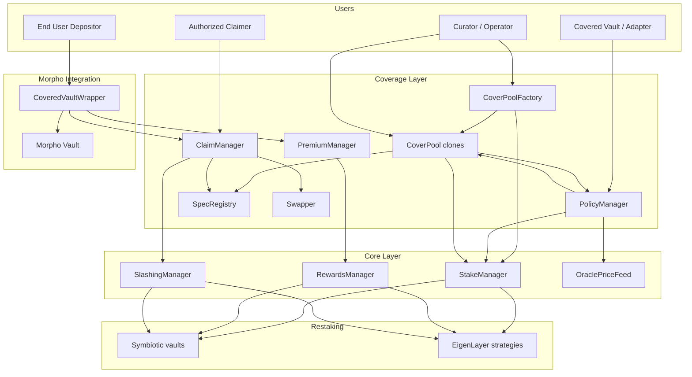

# Coverage System Overview

## Introduction

Catalysis Coverage is the application layer that turns restaked collateral into programmable protection.
It sits on top of Catalysis Core, which abstracts Symbiotic and EigenLayer operations such as committee
creation, stake tracking, reward distribution, and slashing.

Coverage contracts manage:

- pool creation and underwriting policy terms,
- policy request and binding lifecycle,
- premium collection and fee routing, and
- claim adjudication and payout settlement.

Core contracts manage:

- committee capacity and stake accounting,
- operator and vault connectivity to restaking platforms,
- reward fan-out to restaking adapters, and
- slashing execution and collateral return.

## Terminology and Mapping

Coverage and Core share a canonical identifier:

- `policyId` (Coverage) is the same value as `committeeId` (Core).
- committee-level capacity in Core is set from the `coverageLimit` in the bound quote.
- slashing is executed by committee, which means per policy.

Coverage request actor mapping:

- The `buyer` field in policy metadata is the `msg.sender` of `PolicyManager.requestCoverage`; in the `CoveredVaultWrapper` model, `buyer` must be the **wrapper owner** (EOA or multisig), not the wrapper contract itself. `CoveredVaultWrapper._validatePolicyBinding` enforces this with a hard revert.
- The `claimer` is a separately authorized address that can file claims for that policy; in the `CoveredVaultWrapper` model, `claimer` is the wrapper itself.
- The `beneficiary` receives the claim payout; in the `CoveredVaultWrapper` model, `beneficiary` is also the wrapper, which tops up the user's withdrawal atomically.

This 1:1 mapping keeps capacity, accounting, and loss handling aligned across layers.

## High-Level Architecture

## CoveredVaultWrapper Integration Model

For Morpho-style integrations, the insured product is a single `CoveredVaultWrapper`:

- **CoveredVaultWrapper**: UUPS-upgradeable ERC-4626 vault wrapping a Morpho V2 vault; user-facing and premium-bearing.
- **Morpho Vault (underlying)**: yield source; the wrapper is its sole depositor.

Key behaviors:

- premiums accrue continuously on depositor principal via an on-chain accumulator; `collectPremium()` flushes them to `PremiumManager`,
- on normal withdrawal, if the Morpho vault has suffered a loss the wrapper detects the shortfall against the user's insured basis and calls `ClaimManager.fileClaim(...)` atomically,
- the payout is received from `ClaimManager` and forwarded directly to the withdrawing user,
- **emergency exit** (`emergencyRedeem`/`emergencyWithdraw`): users may explicitly waive insurance coverage to exit immediately without triggering a claim, even when a shortfall exists. This is a user-controlled escape hatch, not an insurance bypass.

## Key Design Principles

### 1) Pool-Scoped Underwriting

Each `CoverPool` is curator-controlled and has:

- its own quote signer (`QUOTE_SIGNER_ROLE`),
- independent fee settings (`poolFeeBps`, `feeRecipient`), and
- policy binding authority via pool admin role.

This isolates underwriting strategy and economics across pools.

### 2) Draft-to-Bound Policy Lifecycle

Policies are requested first, then bound later:

1. `PolicyManager.requestCoverage()` creates a draft and committee.
2. Curator binds via `CoverPool.bindPolicyForRequest(...)` once delegation is ready.
3. `PolicyManager.bindPolicy(...)` stores immutable-like policy metadata for claims.

### 3) Core-Mediated Economic Security

Coverage does not slash or distribute rewards directly on restaking protocols.
Instead, Coverage calls Core:

- premium reward routing: `PremiumManager -> RewardsManager`,
- claim-driven slashing: `ClaimManager -> SlashingManager`.

This keeps SSP-specific complexity in Core adapters.

### 4) Parametric Claim Evaluation

Claim logic is delegated to registered `ISpec` implementations:

- pool registers `(pool, specId) -> spec` in `SpecRegistry` at bind time,
- claim path resolves spec from registry and runs `spec.evaluate(context)`.

## End-to-End Flow Summary

1. Curator creates a pool through `CoverPoolFactory`.
2. Factory deploys pool clone; Core `StakeManager` committee is created on coverage request.
3. The wrapper owner (EOA/multisig) requests coverage through `PolicyManager` (draft created, owner recorded as `buyer`).
4. Core committee is created with `committeeId = policyId`; operator assigned.
5. Restakers delegate stake in supported vaults/strategies.
6. Curator binds policy with signed quote and committee vault list.
7. Premiums accrue continuously in `CoveredVaultWrapper` against depositor principal.
8. Anyone calls `CoveredVaultWrapper.collectPremium()`; it flushes accrued premium directly to `PremiumManager.distributePremium()`, which splits fees (platform, pool, restaker), transfers platform and pool shares immediately, and routes the restaker share to `RewardsManager` via an ephemeral per-call `forceApprove` — no standing allowance setup is required.
9. On user withdrawal:
   - no shortfall: `CoveredVaultWrapper` redeems from Morpho and returns assets,
   - shortfall: wrapper calls `ClaimManager.fileClaim(...)` atomically, receives payout, and tops up the user's exit.
10. If claim is payable, `ClaimManager` calls `SlashingManager.previewSlashing` + `executeSlashing` (token-native `VaultSlash[]`), swaps collateral if needed, and pays the `CoveredVaultWrapper` which forwards to the user.

## Scope of This Architecture Set

- [Smart Contracts Architecture](./02-smart-contracts.md)
- [Core Integration](./03-core-integration.md)
- [Restaker Setup and Delegation Lifecycle](./04-restaker-setup.md)
- [Policy Lifecycle](./05-policy-lifecycle.md)
- [Premiums and Claims](./06-premiums-claims.md)
- [CoveredVaultWrapper Accounting](./07-covered-vault-accounting.md)
