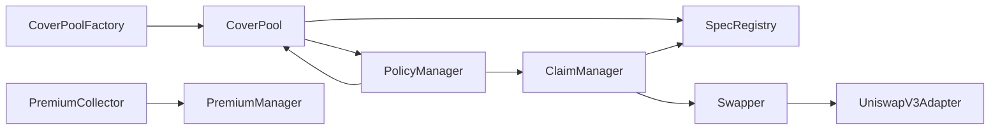

# Coverage Smart Contracts Architecture

## Overview

Coverage contracts are the policy and payout application layer over Catalysis Core.
They are responsible for policy issuance semantics, premium collection/routing, and
claim execution, while Core handles committee stake and SSP-level execution.

## Contract Topology

## Core Coverage Contracts

### 1) CoverPoolFactory

**Role:** Deploys and tracks `CoverPool` clones.

**Pattern and state:**

- UUPS upgradeable proxy.
- Deploys deterministic minimal proxy clones using `Clones.cloneDeterministic`.
- Maintains an internal pool set and pagination helpers.

**Key functions:**

- `createCoverPool(params)` creates and initializes a pool clone, grants curator ownership.
- `computeCoverPoolAddress(params)` predicts deterministic clone address.
- `coverPoolExists(pool)` validates whether a pool is factory-created.

Note: On EigenLayer, duration vaults act as operators and are auto-deployed during committee creation.

**Key role:**

- `CREATOR_ROLE` controls pool creation and major factory settings.

### 2) CoverPool

**Role:** Curator-owned underwriting pool for quote validation and policy binding.

**Pattern and state:**

- Intended for minimal-clone deployment.
- Uses `AccessControlDefaultAdminRulesUpgradeable` for admin transfer safety.
- Maintains bound policy commits and per-policy bound metadata.

**Key functions:**

- `bindPolicyForRequest(policyId, quote, spec, vaults, signature)` performs:
  - draft checks via `PolicyManager`,
  - EIP-712 quote signature verification,
  - spec registration in `SpecRegistry`,
  - committee vault binding in Core via `StakeManager`,
  - final policy bind callback into `PolicyManager`.
- `setPoolFeeBps(...)`, `setFeeRecipient(...)` configure pool economics.

**Key role:**

- `QUOTE_SIGNER_ROLE` defines trusted quote signers.

### 3) PolicyManager

**Role:** Policy draft and bound-policy authority.

**Pattern and state:**

- UUPS upgradeable proxy.
- Stores draft records (`PolicyDraft`) and canonical bound metadata (`PolicyMetadata`).
- Tracks next policy id and policy commit uniqueness.

**Key functions:**

- `requestCoverage(...)`:
  - called by the covered vault (or its adapter) as the `buyer`,
  - commonly sets `claimer` to the cover adapter,
  - commonly sets `beneficiary` to the cover adapter for atomic shortfall top-ups,
  - validates pool and hook,
  - creates policy draft,
  - creates Core committee with `committeeId = policyId`
    (`createCommittee` auto-assigns the pool curator as committee operator).
- `bindPolicy(request, boundPolicy)`:
  - callable by pool only,
  - validates request/draft/quote consistency,
  - verifies stake and vault readiness through Core,
  - stores canonical policy metadata,
  - calls `IBindPolicyHook.onPolicyBound(policyId, coverageLimit)`.

### 4) PremiumCollector

**Role:** Collector of ERC-4626 vault shares and periodic redeemer/distributor.

**Pattern and state:**

- UUPS upgradeable proxy.
- Tracks registered vault configs: underlying token, pool, policyId, and distribution timestamp.
- Supports keeper-style public batch distribution.

**Key functions:**

- `registerVault(vault, pool, policyId)` maps a covered vault to routing metadata.
- `distributeBatch(vaults)` redeems shares to underlying and forwards assets to `PremiumManager`.
- `getDistributableVaults()` surfaces vaults eligible by interval and balance.

### 5) PremiumManager

**Role:** Premium split and restaker reward routing bridge into Core.

**Pattern and state:**

- UUPS upgradeable proxy.
- Holds platform configuration: `platformTreasury`, `platformFeeBps`.

**Key functions:**

- `distributePremium(pool, policyId, premiumToken, amount)`:
  - computes split: platform / pool / restaker,
  - transfers platform fee to treasury,
  - transfers pool fee to pool fee recipient,
  - retains restaker share (SSPRouter pulls it directly via allowance),
  - calls `RewardsManager.distributeRewards(policyId, operator, amount, token)`.
- `approveSpender(token, spender, amount)` grants SSPRouter an allowance to pull the restaker share.
- `getFeeSplits(...)` deterministic split helper.

**Key role:**

- `PREMIUM_COLLECTOR_ROLE` gates premium distribution entrypoint.

### 6) ClaimManager

**Role:** Claim execution engine from filing to payout.

**Pattern and state:**

- UUPS upgradeable proxy.
- Maintains per-policy claim counters, claim records, and cumulative paid-out amount.

**Key functions:**

- `fileClaim(policyId, requestedAmount, evidenceHash, additionalData)`:
  - acts as a file-and-resolve entrypoint (single transaction),
  - validates coverage window and remaining coverage,
  - requires caller equals policy `claimer`,
  - resolves spec and runs evaluation,
  - if payable, executes slashing and collateral processing,
  - transfers payout to beneficiary.
- `remainingCoverage(policyId)` and read models for claims.

**Slashing and payout mechanics:**

- Calls Core `SlashingManager.previewSlashing(committeeId, operator)` to retrieve per-vault token-native stake data.
- Computes `VaultSlash[]` with proportional, token-native slash amounts; non-payout-token vaults receive an upward slippage inflation derived from `Swapper.quoteSwap(...)`, capped at `maxSwapSlippageBps`.
- Calls Core `SlashingManager.executeSlashing(committeeId, operator, vaultSlashes[], taskId)`.
- Processes returned collateral token arrays:
  - direct transfer if already payout token,
  - otherwise swap through `Swapper`.

### 7) SpecRegistry

**Role:** Immutable-style mapping of `(coverPool, specId)` to `ISpec`.

**Pattern and state:**

- UUPS upgradeable proxy.
- Registration is idempotent for the same target and rejects remapping to a different spec.
- Enforces caller is a factory-created pool.

**Key functions:**

- `registerSpec(specId, spec)` called by pool during bind.
- `resolveSpec(pool, specId)` called by `ClaimManager`.

### 8) Swapper

**Role:** Controlled token conversion path for claim collateral.

**Pattern and state:**

- UUPS upgradeable proxy.
- Route registry keyed by `(tokenIn, tokenOut)`.
- Supports whitelisted swap targets and native wrapper semantics.

**Key functions:**

- `setSwapRoute(...)`, `setSwapTargetWhitelist(...)` for configuration.
- `executeSwap(params)` for authorized executors (typically `ClaimManager`).
- `quoteSwap(tokenIn, tokenOut, amountIn)` — non-privileged quote; attempts
  `IQuotableAdapter(swapTarget).quote(tokenIn, tokenOut, amountIn)` in a try/catch, returning 0 on
  failure; used by `ClaimManager` for per-vault slippage inflation and `amountOutMin` MEV protection.

**Key roles:**

- `SWAP_MANAGER_ROLE` configures routes and whitelisted targets.
- `SWAP_EXECUTOR_ROLE` calls `executeSwap` (held by `ClaimManager`).

### 9) UniswapV3Adapter

Two adapter contracts serve the Swapper in this repository:

**`src/swappers/UniswapV3Adapter.sol`** — swap execution adapter (currently deployed via
`script/DeployUniswapV3Adapter.s.sol`). Registered as `swapTarget` in routes. Resolves `amountIn`
from `allowance(Swapper, adapter)` at execution time, then calls `SwapRouter02.exactInputSingle`
with `recipient = Swapper`. Does **not** implement `IQuotableAdapter`; `Swapper.quoteSwap` gracefully
returns 0 for routes using this adapter alone (try/catch).

**`src/adapters/UniswapV3Adapter.sol`** — quote-only adapter implementing `IQuotableAdapter`.
When registered as `swapTarget`, enables `Swapper.quoteSwap` to obtain live Uniswap V3 price quotes
via `QuoterV2.quoteExactInputSingle`, powering `ClaimManager`'s per-vault slippage inflation and
`amountOutMin` MEV protection. Uses `Ownable2Step` with per-pair fee tier overrides via `setPairFee`.
Does **not** contain a `swap()` function; for production use it must be paired with a swap-capable
target or the deploy script updated to register an adapter that implements both interfaces.

**Swap execution pattern** (`ClaimManager._processCollateral` → `Swapper.executeSwap`):

1. `ClaimManager` approves `Swapper` for the collateral amount.
2. `Swapper.executeSwap` calls `forceApprove(swapTarget, amountIn)` and then `swapTarget.call(swapCalldata)`.
3. The stored `swapCalldata` (set via `setSwapRoute`) encodes the swap selector (`swap(tokenIn, tokenOut, fee)`)
   and static route parameters. The DEX executes the swap and delivers `tokenOut` to `Swapper`.
4. `Swapper` verifies output via balance diff and transfers to the recipient.

**Quote pattern** (`ClaimManager._computeVaultSlashes` / `_processCollateral` → `Swapper.quoteSwap`):

1. `Swapper.quoteSwap` looks up the route and calls `IQuotableAdapter(swapTarget).quote(tokenIn, tokenOut, amountIn)`.
2. If `swapTarget` implements `IQuotableAdapter` (i.e. `src/adapters/UniswapV3Adapter`), `quote` calls
   `QuoterV2.quoteExactInputSingle` with the configured fee tier and returns the simulated output.
3. If `swapTarget` does not implement `IQuotableAdapter` (i.e. `src/swappers/UniswapV3Adapter`), the call
   reverts and the Swapper's try/catch returns 0 — slippage inflation and MEV quoting degrade gracefully.

**Deployment:** `script/DeployUniswapV3Adapter.s.sol` deploys `src/swappers/UniswapV3Adapter`, whitelists
it in `Swapper`, and configures the route in one transaction.

| Network | SwapRouter02 |
|---------|-------------|
| Sepolia | `0x3bFA4769FB09eefC5a80d6E87c3B9C650f7Ae48E` |
| Mainnet | `0x68b3465833fb72A70ecDF485E0e4C7bD8665Fc45` |

## Covered Vault Integration Components (Morpho)

These components typically live outside this repository but are first-class architecture actors.

### Covered Vault (Morpho V2)

- user-facing insured vault,
- sets management-fee style premium parameters (via curator controls),
- allocates/deallocates through the adapter.

### CatalysisCoverAdapter

- implements Morpho adapter interface,
- tracks principal/reference accounting for shortfall detection,
- calls Coverage policy and claims entrypoints (`requestCoverage`, `fileClaim`) as integration policy dictates,
- receives claim payout and forwards make-whole assets through withdrawal path.

### Base Vault (Morpho V1/V2)

- underlying yield venue where adapter actually places capital,
- can be shared with uninsured users outside the covered vault.

## Upgrade and Access-Control Model

All major contracts are UUPS upgradeable (except CoverPool clones, which are minimal proxies).

Typical control planes:

- `DEFAULT_ADMIN_ROLE` for contract-wide configuration and upgrades.
- specialized roles for restricted entrypoints:
  - `CREATOR_ROLE` on factory,
  - `QUOTE_SIGNER_ROLE` on pools,
  - `PREMIUM_COLLECTOR_ROLE` on premium manager,
  - `SWAP_MANAGER_ROLE` / `SWAP_EXECUTOR_ROLE` on swapper.

## Integration Dependencies

Coverage contracts rely on Core interfaces:

- `IStakeManager` for committee create/operator/vault and stake reads,
- `IRewardsManager` for reward fan-out trigger,
- `ISlashingManager` for committee slashing preview and execution,
- `IChainlinkPriceFeed` (via `PolicyManager`) for USD-based stake sufficiency check at bind time.

## Next Steps

- [Core Integration](./03-core-integration.md)
- [Covered Vault Integration](./07-covered-vault-integration.md)
- [Policy Lifecycle](./05-policy-lifecycle.md)
- [Premiums and Claims](./06-premiums-claims.md)
