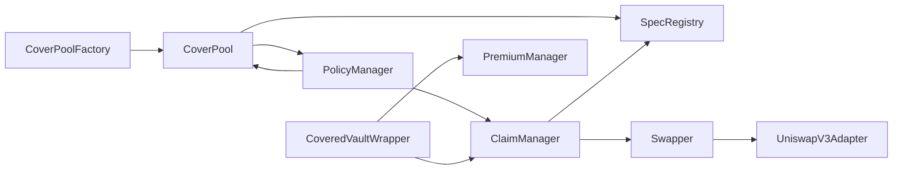

# Coverage Smart Contracts Architecture

## Overview

Coverage contracts are the policy and payout application layer over Catalysis Core.
They are responsible for policy issuance semantics, premium collection/routing, and
claim execution, while Core handles committee stake and SSP-level execution.

## Contract Topology

## Core Coverage Contracts

### 1) CoverPoolFactory

**Role:** Deploys and tracks `CoverPool` clones.

**Pattern and state:**

- UUPS upgradeable proxy.
- Deploys deterministic minimal proxy clones using `Clones.cloneDeterministic`.
- Maintains an internal pool set and pagination helpers.

**Key functions:**

- `createCoverPool(params)` creates and initializes a pool clone, grants curator ownership.
- `computeCoverPoolAddress(params)` predicts deterministic clone address.
- `coverPoolExists(pool)` validates whether a pool is factory-created.

Note: On EigenLayer, duration vaults act as operators and are auto-deployed during committee creation.

**Key role:**

- `CREATOR_ROLE` controls pool creation and major factory settings.

### 2) CoverPool

**Role:** Curator-owned underwriting pool for quote validation and policy binding.

**Pattern and state:**

- Intended for minimal-clone deployment.
- Uses `AccessControlDefaultAdminRulesUpgradeable` for admin transfer safety.
- Maintains bound policy commits and per-policy bound metadata.

**Key functions:**

- `bindPolicyForRequest(policyId, quote, spec, vaults, signature)` performs:
  - draft checks via `PolicyManager`,
  - EIP-712 quote signature verification,
  - spec registration in `SpecRegistry`,
  - committee vault binding in Core via `StakeManager`,
  - final policy bind callback into `PolicyManager`.
- `setPoolFeeBps(...)`, `setFeeRecipient(...)` configure pool economics.

**Key role:**

- `QUOTE_SIGNER_ROLE` defines trusted quote signers.

### 3) PolicyManager

**Role:** Policy draft and bound-policy authority.

**Pattern and state:**

- UUPS upgradeable proxy.
- Stores draft records (`PolicyDraft`) and canonical bound metadata (`PolicyMetadata`).
- Tracks next policy id and policy commit uniqueness.

**Key functions:**

- `requestCoverage(...)`:
  - called by the `CoveredVaultWrapper` (or more generally a covered vault / its agent) as the `buyer`,
  - commonly sets `claimer` to `CoveredVaultWrapper` (files claims atomically on withdrawal shortfall),
  - commonly sets `beneficiary` to `CoveredVaultWrapper` for atomic shortfall top-ups,
  - validates pool and hook,
  - creates policy draft,
  - creates Core committee with `committeeId = policyId` via `StakeManager.createCommittee(policyId, pool, duration)`,
  - then explicitly calls `StakeManager.addOperatorToCommittee(curator, policyId)` to register the pool curator as operator.
- `bindPolicy(request, boundPolicy)`:
  - callable by pool only,
  - validates request/draft/quote consistency,
  - verifies stake and vault readiness through Core,
  - stores canonical policy metadata,
  - calls `IBindPolicyHook.onPolicyBound(policyId, coverageLimit)`.

### 4) PremiumManager

**Role:** Premium split and restaker reward routing bridge into Core.

**Pattern and state:**

- UUPS upgradeable proxy.
- Holds platform configuration: `platformTreasury`, `platformFeeBps`.
- Maintains an admin-controlled set of approved premium tokens; `distributePremium` reverts for any unapproved token.

**Key functions:**

- `distributePremium(pool, policyId, premiumToken, amount)`:
  - permissionless entrypoint — any caller (typically `CoveredVaultWrapper.collectPremium()`) may call it,
  - requires: `pool` has a bound policy for `policyId`, `premiumToken` is in the approved token set,
  - pulls `amount` from the caller via `safeTransferFrom`, so the caller must have approved `PremiumManager` first,
  - computes split: platform / pool / restaker,
  - transfers platform fee to `platformTreasury`,
  - transfers pool fee to pool `feeRecipient`,
  - calls `RewardsManager.distributeRewards(policyId, curator, restakerSplit, token, taskId)`;
    `RewardsManager` then pulls the restaker share from `PremiumManager` to itself and routes via `SSPRouter`.
- `approveSpender(token, spender, amount)` grants a spender (typically `RewardsManager`) an unlimited allowance to pull the restaker share from `PremiumManager`.
- `addApprovedPremiumToken(token)` / `removeApprovedPremiumToken(token)` admin management of allowed premium tokens.
- `isApprovedPremiumToken(token)` / `approvedPremiumTokens()` view helpers.
- `getFeeSplits(...)` deterministic split helper.

**Access control:** `DEFAULT_ADMIN_ROLE` for configuration; `distributePremium` has no role requirement.

### 5) ClaimManager

**Role:** Claim execution engine from filing to payout.

**Pattern and state:**

- UUPS upgradeable proxy.
- Maintains per-policy claim counters, claim records, and cumulative paid-out amount.

**Key functions:**

- `fileClaim(policyId, requestedAmount, evidenceHash, additionalData)`:
  - file-and-resolve entrypoint (single transaction),
  - requires `claimApprovalRequired[policyId] == false`; curator must call `approveNextClaim` between successive claims,
  - validates coverage window, remaining coverage, non-zero/unique evidence hash, and `!premiumDefaulted`,
  - requires caller equals policy `claimer`,
  - resolves spec and runs evaluation,
  - if payable, executes slashing and collateral processing, then sets `claimApprovalRequired[policyId] = true`,
  - transfers payout to beneficiary.
- `approveNextClaim(policyId)` — called by the policy curator to clear the approval gate after each approved claim.
- `claimApprovalRequired(policyId)` — view: whether curator approval is required before the next claim.
- `remainingCoverage(policyId)` and read models for claims.

**Slashing and payout mechanics (token-native, no oracle):**

1. `SlashingManager.previewSlashing(committeeId, operator)` returns per-vault collateral tokens and token-native stake amounts.
2. `_computeVaultSlashes` quotes each cross-token stake via `Swapper.quoteSwap` to determine payout-equivalent values, then computes proportional token-native slash amounts per vault; cross-token amounts are inflated by `1 / (1 - maxSwapSlippageBps)` to absorb worst-case swap slippage.
3. `SlashingManager.executeSlashing(committeeId, operator, VaultSlash[], taskId)` executes slashing and returns seized collateral.
4. For each collateral token:
   - if it already equals `payoutToken`: transfer directly to beneficiary (surplus forwarded via `PremiumManager.distributeSurplusAsRewards` to `RewardsManager`),
   - otherwise: swap through `Swapper` using `quoteSwap`-derived `amountOutMin`; surplus forwarded via `PremiumManager.distributeSurplusAsRewards` to `RewardsManager`.

No USD conversion or `ChainlinkPriceFeed` is used in the claim execution path.

### 6) SpecRegistry

**Role:** Immutable-style mapping of `(coverPool, specId)` to `ISpec`, with admin-controlled spec approval.

**Pattern and state:**

- UUPS upgradeable proxy.
- Registration is idempotent for the same target and rejects remapping to a different spec.
- Enforces caller is a factory-created pool.
- Maintains an admin-approved whitelist of `ISpec` implementation addresses. A spec must be approved before any pool can register it.

**Key functions:**

- `approveSpec(spec)` called by admin to whitelist a trusted `ISpec` implementation.
- `revokeSpec(spec)` called by admin to remove an `ISpec` from the whitelist.
- `isSpecApproved(spec)` view helper to check whether a spec is currently approved.
- `registerSpec(specId, spec)` called by pool during bind; reverts with `SpecNotApproved` if the spec is not on the whitelist.
- `resolveSpec(pool, specId)` called by `ClaimManager`; resolution is not gated by approval status so in-flight claims on existing policies are unaffected by revocations.

### 7) Swapper

**Role:** Controlled token conversion path for claim collateral.

**Pattern and state:**

- UUPS upgradeable proxy.
- Route registry keyed by `(tokenIn, tokenOut)`.
- Supports whitelisted swap targets and native wrapper semantics.

**Key functions:**

- `setSwapRoute(...)`, `setSwapTargetWhitelist(...)` for configuration.
- `executeSwap(params)` for authorized executors (typically `ClaimManager`).

**Key roles:**

- `SWAP_MANAGER_ROLE` configures routes and whitelisted targets.
- `SWAP_EXECUTOR_ROLE` calls `executeSwap` (held by `ClaimManager`).

### 8) UniswapV3Adapter

**Role:** Bridges the Swapper's static-calldata pattern to Uniswap V3 `SwapRouter02`.

**Why it exists:** The Swapper stores one static calldata blob per `(tokenIn, tokenOut)` route and
replays it verbatim on every swap. Uniswap V3's `exactInputSingle` requires the `amountIn` to be
encoded in each call, making a direct route impossible. The adapter resolves `amountIn` dynamically
from the allowance the Swapper grants it.

**Integration pattern** (called by `Swapper._performSwap`):

1. Swapper approves adapter for `amountIn` of `tokenIn`.
2. Swapper calls `adapter.swap(tokenIn, tokenOut, fee, amountOutMinimum)` via stored static calldata.
3. Adapter reads `allowance(Swapper, adapter)` to obtain `amountIn`.
4. Adapter pulls `tokenIn` from Swapper via `transferFrom`.
5. Adapter calls `SwapRouter02.exactInputSingle` forwarding `amountOutMinimum` for router-level slippage enforcement.
6. Router delivers `tokenOut` directly to Swapper.
7. Adapter clears residual approval to the router.

**Slippage protection:** The `amountOutMinimum` parameter is forwarded directly to the Uniswap V3
router, enabling defense-in-depth slippage protection at the adapter level.

**Access control:** `swap()` is restricted to the `SWAPPER` address recorded at construction time.
Only the authorized Swapper contract may invoke the adapter, enforcing the principle of least
privilege. Any third-party call is rejected with `UnauthorizedCaller()`.

**Deployment:** `script/DeployUniswapV3Adapter.s.sol` deploys the adapter (passing the `SWAPPER`
address as a constructor argument), whitelists it in `Swapper`, and configures the route in one
transaction. Since `UniswapV3Adapter` is an immutable contract, any change to the adapter requires
deploying a new instance and reconfiguring the Swapper route via `setSwapTargetWhitelist` +
`setSwapRoute`.

| Network | SwapRouter02 |
|---------|-------------|
| Sepolia | `0x3bFA4769FB09eefC5a80d6E87c3B9C650f7Ae48E` |
| Mainnet | `0x68b3465833fb72A70ecDF485E0e4C7bD8665Fc45` |

## Covered Vault Integration Components (Morpho)

These components live in `src/defi/` and are first-class architecture actors.

### CoveredVaultWrapper

- UUPS-upgradeable ERC-4626 vault that wraps a Morpho V2 vault,
- accrues premiums continuously against depositor principal via a reward-per-token accumulator,
- exposes `collectPremium()` (permissionless) which flushes accrued premium to `PremiumManager.distributePremium()`,
- detects shortfall on withdrawal by comparing `insuredBasis` (principal minus paid premium) against proceeds from the Morpho vault,
- calls `ClaimManager.fileClaim(...)` atomically during withdrawal when a shortfall exists,
- receives claim payout and tops up the user's withdrawal to make them whole.

## Upgrade and Access-Control Model

All major contracts are UUPS upgradeable (except CoverPool clones, which are minimal proxies).

Typical control planes:

- `DEFAULT_ADMIN_ROLE` for contract-wide configuration and upgrades.
- specialized roles for restricted entrypoints:
  - `CREATOR_ROLE` on factory,
  - `QUOTE_SIGNER_ROLE` on pools,
  - `SWAP_MANAGER_ROLE` / `SWAP_EXECUTOR_ROLE` on swapper.
- On `SpecRegistry`, `DEFAULT_ADMIN_ROLE` additionally controls the spec approval whitelist
  (`approveSpec` / `revokeSpec`). Only admin-approved `ISpec` implementations may be registered
  by cover pool curators.

## Integration Dependencies

Coverage contracts rely on Core interfaces:

- `IStakeManager` for committee create/operator/vault and stake reads,
- `IRewardsManager` for reward fan-out trigger,
- `ISlashingManager` for committee slashing execution,
- `IChainlinkPriceFeed` for stake-to-USD conversion at bind time (stake sufficiency check in `PolicyManager`).

## Next Steps

- [Core Integration](./03-core-integration.md)
- [Policy Lifecycle](./05-policy-lifecycle.md)
- [Premiums and Claims](./06-premiums-claims.md)
- [CoveredVaultWrapper Accounting](../COVERED_VAULT_ACCOUNTING.md)
