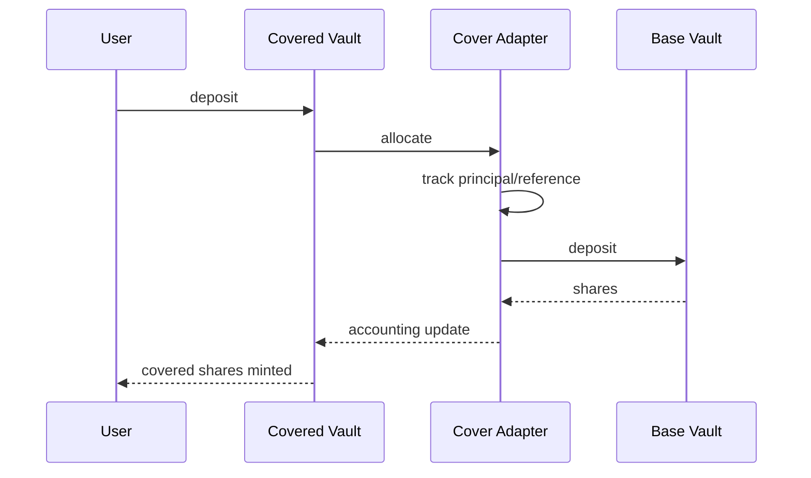
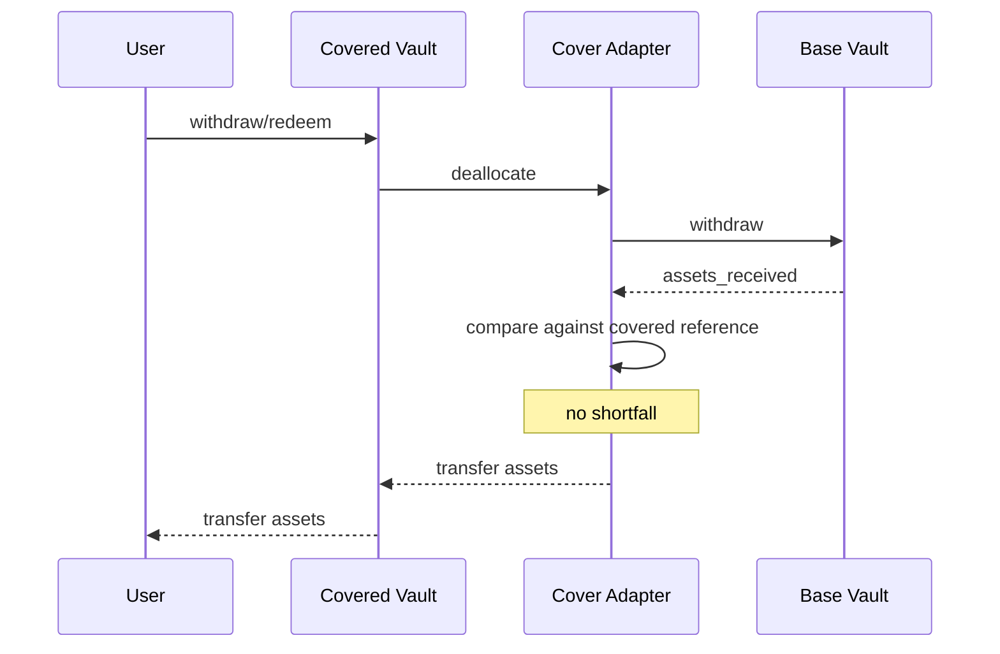
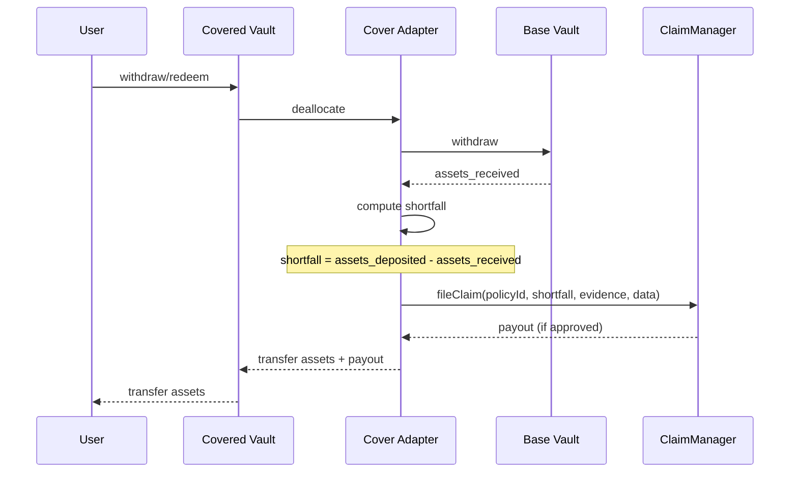
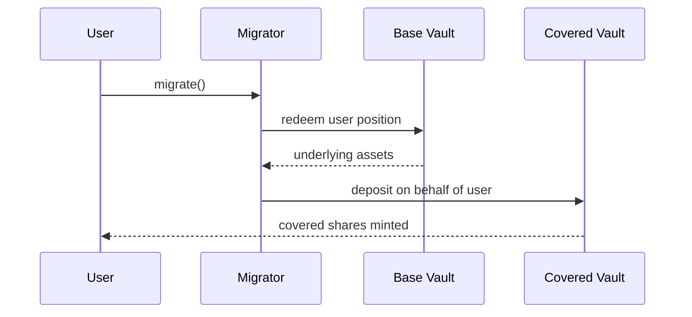

# Covered Vault Integration (Morpho Adapter Model)

## Overview

This page documents the adapter-based Morpho integration pattern used for insured vaults.

Core idea:

- users choose between an uninsured base vault and an insured covered vault,
- the covered vault allocates through a Catalysis adapter,
- withdrawal-time shortfall is optionally repaired through Coverage claim payout.

## Components

### Covered Vault (Morpho V2)

- user-facing insured vault,
- accrues premium via management-fee-like mechanism,
- allocates to the adapter.

### CatalysisCoverAdapter

- Morpho adapter implementation,
- allocates/deallocates into the base vault,
- tracks reference accounting for shortfall detection,
- calls Coverage claim path on shortfall.

### Base Vault (Morpho V1/V2)

- underlying investment destination,
- may also serve uninsured users directly.

## Policy Actor Mapping for This Integration

Typical settings in `PolicyManager.requestCoverage(...)`:

- `buyer`: covered vault or adapter contract,
- `claimer`: adapter,
- `beneficiary`: adapter,
- `bindPolicyHook`: adapter.

Recommended token alignment:

- set policy `payoutToken` to the base-vault underlying asset (for direct make-whole transfer),
- otherwise adapter must convert payout token into the withdrawal asset before forwarding.

This allows the adapter to receive payout and complete atomic make-whole flow.

## Flow 1: Deposit

## Flow 2: Withdrawal (No Shortfall)

## Flow 3: Withdrawal (With Shortfall)

Notes:

- Some external docs call this `fileAndResolveClaim(...)`.
- In current Coverage contracts, `ClaimManager.fileClaim(...)` is atomic (file + resolve).

## Flow 4: Migration (Base -> Covered)

## Coverage/Core Touchpoints in This Model

- policy request: `PolicyManager.requestCoverage(...)`,
- policy binding: `CoverPool.bindPolicyForRequest(...)`,
- premium routing: `PremiumCollector -> PremiumManager -> RewardsManager`,
- claim execution: `ClaimManager.fileClaim(...) -> SlashingManager.executeSlashing(...)`.

## Related Pages

- [System Overview](./01-system-overview.md)
- [Policy Lifecycle](./05-policy-lifecycle.md)
- [Premiums and Claims](./06-premiums-claims.md)
