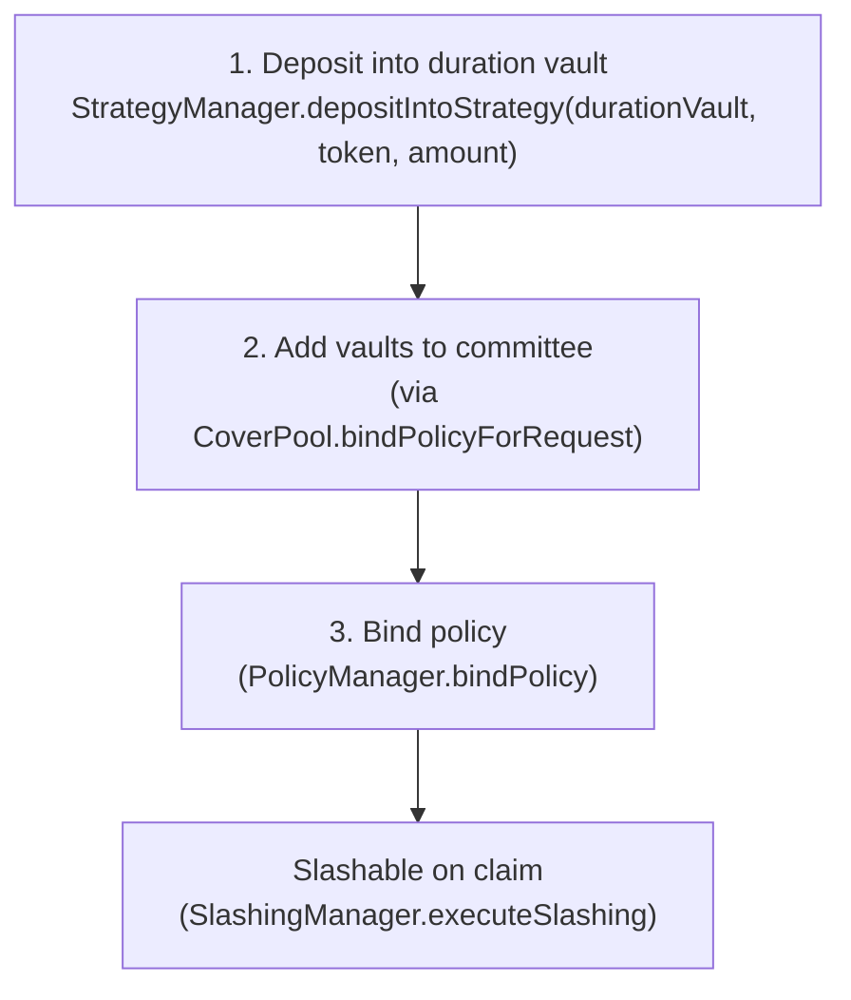

# Restaker Setup and Delegation Lifecycle

## Overview

Before a policy can be bound, the restaker must complete a deposit setup that makes their stake
slashable by the policy's committee. This process involves depositing directly into an EigenLayer
duration vault (and optionally a Symbiotic vault).

The restaker deposit is performed directly against EigenLayer contracts (no Coverage script needed).
`script/testing/CompleteCoverageFlow.s.sol` verifies stake sufficiency in Phase 4 before binding.

## Duration Vault Model (EigenLayer)

On EigenLayer, **duration vaults (`DurationVaultStrategy`) act as the operator** — the curator
does NOT register as an EigenLayer operator, set an allocation delay, allocate magnitude, or
register to an operator set. The vault handles all of this internally:

- When `PolicyManager.requestCoverage` is called, it triggers `StakeManager.createCommittee`,
  which calls `SSPRouter.createCommittee`.
- `SSPRouter.createCommittee` automatically deploys a `DurationVaultStrategy` contract (via
  `EigenAdapter.deployDurationVaultStrategy`) for each acceptable collateral token.
- Each `DurationVaultStrategy` registers itself as an EigenLayer operator and operator set upon
  deployment.
- Restakers deposit collateral directly into the duration vault through EigenLayer's
  `StrategyManager.depositIntoStrategy(durationVault, token, amount)`.
- No separate magnitude allocation or operator set registration is needed from the restaker.

## EigenLayer Delegation Lifecycle for a Committee



### Step 1: Deposit into Duration Vault

The restaker deposits collateral into the `DurationVaultStrategy` auto-deployed by
`EigenAdapter.deployDurationVaultStrategy` when the committee was created. Deposits go through
EigenLayer's standard `StrategyManager`:

```solidity
IERC20(token).approve(eigenStrategyManager, amount);
IStrategyManager(eigenStrategyManager).depositIntoStrategy(durationVault, token, amount);
```

The `durationVault` address is the `DurationVaultStrategy` contract deployed for this committee.
It acts as both an EigenLayer strategy (accepts deposits) and an EigenLayer operator (is
slashable). Its address is stored in `StakeManager.getCommitteeVaults(policyId)` after committee
creation.

The deposited amount must satisfy the coverage USD requirement. The USD value is computed by
`EigenAdapter.getStrategiesStakeUSD(vaults)` at bind time:

```
stake_USD = totalShares * sharesToUnderlyingView() * ChainlinkPriceFeed.getUSDValue(token, 1e18) / 1e18
```

Example: to cover `coverageAmount = 100_000_000_000` (1000 USD at 8 decimals), at least
`$1000 / ETH_USD_PRICE` ETH worth of WETH must be deposited.

### Steps 2 & 3: Add Vaults and Bind Policy

These steps are performed by the curator via `CoverPool.bindPolicyForRequest(...)`, which:

1. calls `StakeManager.addCommitteeVaults(policyId, [durationVaultStrategy])` — registers the
   vault as a committee vault and calls `EigenAdapter.addStrategiesToOperatorSet` to configure it,
2. calls `PolicyManager.bindPolicy(...)` — verifies that stake ≥ `coverageAmount` (via
   `StakeManager.getCommitteeTotalStakeUSD`) and activates the policy.

The `_checkDelegation` call inside `SSPRouter.addCommitteeVaults` computes
`EigenAdapter.getStrategiesStakeUSD(vaults)` and reverts with
`InsufficientDelegationAmount` if the stake is insufficient.

## Why a Separate Setup Phase Exists

Policy binding (`BindPolicy.s.sol`) and restaker deposit are deliberately separated because:

- **Different actors and keys**: deposit uses the restaker key; binding uses the curator key and
  quote signer key.
- **Asynchronous stake propagation**: after deposit, the USD value reported by `EigenAdapter` may
  take one or more blocks to reflect on-chain price feed data.
- **One-time vs per-policy**: stake deposit is per-restaker/committee setup; binding is per-policy.
- **Protocol boundary**: the deposit phase crosses EigenLayer/Symbiotic APIs directly; the bind
  phase only touches Coverage and Core contracts.

## Premium Reward Flow

After policy binding and premium collection, premiums are distributed as follows:

1. `PremiumCollector` redeems vault shares and transfers underlying to `PremiumManager`.
2. `PremiumManager.distributePremium` splits the amount into platform fee, pool fee, and restaker
   share. Platform and pool fees are transferred immediately. The **restaker share stays in
   `PremiumManager`** — it is NOT transferred to `RewardsManager`.
3. `PremiumManager` calls `RewardsManager.distributeRewards(policyId, curator, amount, token, taskId)`.
4. `RewardsManager` calls `SSPRouter.distributeRewards(..., tokenSource=premiumManager)`.
5. `SSPRouter` pulls the tokens directly from `PremiumManager` via
   `token.safeTransferFrom(premiumManager, adapter, amount)`.

**Prerequisite**: admin must call `PremiumManager.approveSpender(token, sspRouter, type(uint256).max)`
once during initial setup so that SSPRouter has an unlimited allowance to pull tokens.

## Symbiotic Path (Out of Scope for E2E Testing)

Symbiotic integration is supported by the core contracts but is **out of scope for e2e testing**.
The `PrepareBindPolicy.s.sol` script covers EigenLayer only.

## Vault Module Registration Prerequisite

Before any vault can be bound to a committee, the core admin must register it in `SSPRouter`:

```bash
cast send $SSPROUTER "registerVaultModule(address,uint8)" $VAULT_ADDRESS 2 \
  --private-key $CORE_ADMIN_PRIVATE_KEY --rpc-url $RPC_URL
# 2 = EIGENLAYER; 1 = SYMBIOTIC
```

For duration vaults auto-deployed by `createCommittee`, this is handled automatically.

Verify:
```bash
cast call $SSPROUTER "getVaultModule(address)(uint8)" $VAULT_ADDRESS --rpc-url $RPC_URL
# Expected: 2 (EIGENLAYER) or 1 (SYMBIOTIC)
```

## Stake Sufficiency Check at Bind Time

The delegation check inside `SSPRouter.addCommitteeVaults` verifies:

```
EigenAdapter.getStrategiesStakeUSD(eigenVaults)
  + SymbioticAdapter.getOperatorStakeUSD(operator, symbioticVaults, committeeId)
  >= SSPRouter.committeeMaxStake[committeeId]
```

Where `committeeMaxStake[committeeId]` was set during `SSPRouter.createCommittee` (called from
`StakeManager.createCommittee`, which was called from `PolicyManager.requestCoverage`).

`committeeMaxStake` equals the `coverageAmount` from the policy request, denominated in USD
(8 decimal places). For example, a `coverageAmount` of `100_000_000_000` means $1,000 USD.

## Restaker Deposit Reference

The restaker deposit is a single direct EigenLayer call — no Coverage script is needed.
Get the `durationVault` address from `StakeManager.getCommitteeVaults(policyId)[0]` after committee creation.

```bash
# 1. Approve collateral token to EigenLayer StrategyManager
cast send $COLLATERAL_TOKEN "approve(address,uint256)" $EIGEN_STRATEGY_MANAGER $DEPOSIT_AMOUNT \
  --private-key $RESTAKER_PRIVATE_KEY --rpc-url $RPC_URL

# 2. Deposit into the duration vault
cast send $EIGEN_STRATEGY_MANAGER \
  "depositIntoStrategy(address,address,uint256)" \
  $EIGEN_DURATION_VAULT $COLLATERAL_TOKEN $DEPOSIT_AMOUNT \
  --private-key $RESTAKER_PRIVATE_KEY --rpc-url $RPC_URL
```

| Variable | Description |
|----------|-------------|
| `RESTAKER_PRIVATE_KEY` | Restaker private key |
| `EIGEN_STRATEGY_MANAGER` | EigenLayer StrategyManager address |
| `EIGEN_DURATION_VAULT` | DurationVaultStrategy for this committee (`StakeManager.getCommitteeVaults(policyId)[0]`) |
| `COLLATERAL_TOKEN` | Collateral token accepted by the duration vault |
| `DEPOSIT_AMOUNT` | Amount to deposit (wei) |

## Key Addresses on Sepolia

| Component | Address |
|-----------|---------|
| EigenLayer DelegationManager | `0xD4A7E1Bd8015057293f0D0A557088c286942e84b` |
| EigenLayer StrategyManager | `0x2E3D6c0744b10eb0A4e6F679F71554a39Ec47a5D` |
| EigenAdapter (AVS) | `0xA28871e253C972A96003D3f432CA4170f4ae2A78` |
| SSPRouter | `0xc2F3906Bb57c8Db7DF2DddF0f2CEc521fE6834f8` |

Duration vault addresses are looked up at runtime via `StakeManager.getCommitteeVaults(policyId)`.

## Common Failure Modes

| Symptom | Root Cause | Fix |
|---------|-----------|-----|
| `InsufficientDelegationAmount` at bind | `getStrategiesStakeUSD` < `committeeMaxStake` | Deposit more collateral or reduce `COVERAGE_AMOUNT` |
| `VaultModuleNotSet` at `addCommitteeVaults` | Duration vault not registered in `SSPRouter` | Core admin: `SSPRouter.registerVaultModule(vault, 2)` |
| `PriceFeedNotFound` at `fileClaim` | WETH not registered in `ChainlinkPriceFeed` | Core admin: `registerPriceFeed(WETH, ETH/USD_aggregator)` |
| `InvalidCommitteeId` | `policyId = 0` (not set from output of RequestCoverage) | Set `POLICY_ID` env var from `RequestCoverage.s.sol` output |
| Stake reads 0 before bind | Vaults not yet added to committee (expected) | Stake = 0 until `bindPolicyForRequest` runs `addCommitteeVaults` |
| `SSPRouter safeTransferFrom` reverts on distribution | PremiumManager has not approved SSPRouter | Admin: `PremiumManager.approveSpender(token, sspRouter, type(uint256).max)` |

## Related Pages

- [Core Integration](./03-core-integration.md)
- [Policy Lifecycle](./05-policy-lifecycle.md)
- [Premiums and Claims](./06-premiums-claims.md)
