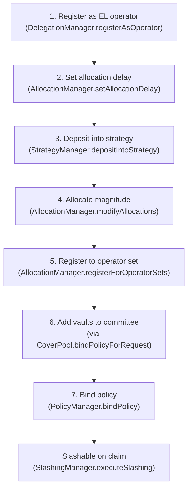

# Restaker Setup and EigenLayer Operator Lifecycle

## Overview

Before a policy can be bound, the restaker (curator/operator) must complete a multi-step
off-chain setup that makes their deposited stake slashable by the policy's committee. This
process involves interacting directly with EigenLayer (and optionally Symbiotic) contracts.

The setup is performed **once per operator** for EigenLayer-level steps (deposit, allocation delay)
and **once per committee** for committee-specific steps (magnitude allocation, operator set
registration).

The coverage script `script/testing/PrepareBindPolicy.s.sol` implements all phases of this setup.

## Why a Separate Setup Phase Exists

Policy binding (`BindPolicy.s.sol`) and restaker delegation are deliberately separated because:

- **Different actors and keys**: deposit/allocation uses the operator key; binding uses the curator
  key and quote signer key.
- **Protocol timing gap**: EigenLayer's `modifyAllocations` takes effect at `effectBlock`, not
  immediately. With `allocationDelay = 0`, the allocation is effective in the next block, but the
  sequence must still be: deposit → allocate → (wait) → register → bind.
- **One-time vs per-policy**: stake deposit and operator registration are per-operator setup;
  binding is per-policy and per-committee.
- **Protocol boundary**: the deposit phase crosses EigenLayer/Symbiotic APIs directly; the bind
  phase only touches Coverage and Core contracts.

## EigenLayer Operator Lifecycle for a Committee



### Step 1: Register as EigenLayer Operator

The curator must be a registered EigenLayer operator before any committee can be assigned to them.

```solidity
IDelegationManager(delegationManager).registerAsOperator(
    address(0),   // delegationApprover (0 = permissionless delegation)
    0,            // allocationDelay (blocks; set to 0 for testnet)
    ""            // metadataURI
);
```

This is typically done during pool creation via `CreateCoverPool.s.sol`. Check:
```bash
cast call $DELEGATION_MANAGER "isOperator(address)(bool)" $OPERATOR --rpc-url $RPC_URL
```

### Step 2: Set Allocation Delay

The allocation delay controls how many blocks must pass before a `modifyAllocations` call takes
effect. Setting it to 0 means allocations are effective from the next block.

```solidity
IAllocationManager(allocationManager).setAllocationDelay(operator, 0);
```

This is idempotent — if already set, the call is skipped by `PrepareBindPolicy.s.sol`.

### Step 3: Deposit into EigenLayer Strategy

The operator must deposit collateral into a registered EigenLayer strategy. The strategy must
be registered in `SSPRouter` with module type `EIGENLAYER` (2) before it can be used as a
committee vault.

```solidity
IERC20(token).approve(strategyManager, amount);
IStrategyManager(strategyManager).depositIntoStrategy(strategy, token, amount);
```

**Sepolia WETH strategy:** `0x424246ef71b01ee33aa33ac590fd9a0855f5efbc`  
(underlying token: WETH `0x7b79995e5f793A07Bc00c21412e50Ecae098E7f9`)

The deposited amount must satisfy the coverage USD requirement. The USD value is computed by
`EigenAdapter.getStrategiesStakeUSD(operator, vaults)` at bind time:

```
stake_USD = shares * sharesToUnderlyingView(shares) * ChainlinkPriceFeed.getUSDValue(token, 1e18) / 1e18
```

Example: to cover `coverageAmount = 100_000_000_000` (1000 USD at 8 decimals), the operator
needs at least `$1000 / ETH_USD_PRICE` ETH worth of WETH deposited.

### Step 4: Allocate Magnitude

Magnitude allocation makes the deposited stake slashable by the committee's EigenLayer operator
set. The operator set id equals the `policyId`.

```solidity
IAllocationManager(allocationManager).modifyAllocations(
    operator,
    [AllocateParams({
        operatorSet: OperatorSet({avs: eigenAdapter, id: uint32(policyId)}),
        strategies: [strategy],
        newMagnitudes: [10000]  // 10000 = 100% of available magnitude
    })]
);
```

The `avs` address is the `EigenAdapter` proxy address. The `operatorSetId` equals `policyId`.

After this call, `AllocationManager.getAllocation(operator, (eigenAdapter, policyId), strategy)`
returns `(magnitude=10000, effectBlock=..., ...)`.

### Step 5: Register to the Operator Set (REQUIRED for Slashing)

**This step is critical and commonly missed.** An operator can have magnitude allocated to an
operator set without being a registered *member* of that set. Only registered members are
slashable via `AllocationManager.slashOperator`.

```solidity
IAllocationManager(allocationManager).registerForOperatorSets(
    operator,
    RegisterParams({
        avs: eigenAdapter,          // EigenAdapter proxy address
        operatorSetIds: [policyId], // cast to uint32
        data: bytes("")
    })
);
```

> The `EigenAdapter` acts as its own AVS registrar (set via `setAVSRegistrar()`). Its `onRegister`
> hook is a no-op, so any operator can register without approval.

Verify registration:
```bash
cast call $ALLOCATION_MANAGER "isOperatorSlashable(address,(address,uint32))(bool)" \
  $OPERATOR "($EIGEN_ADAPTER,$POLICY_ID)" --rpc-url $RPC_URL
# Expected: true
```

If `isOperatorSlashable` returns `false` at claim time, `SlashingManager.executeSlashing` will
revert and the claim payout will fail.

### Step 6 & 7: Add Vaults and Bind Policy

These steps are performed by the curator via `CoverPool.bindPolicyForRequest(...)`, which:

1. calls `StakeManager.addCommitteeVaults(policyId, [strategy])` — registers the strategy as a
   committee vault and calls `EigenAdapter.addStrategiesToOperatorSet` to add it to the EigenLayer
   operator set,
2. calls `PolicyManager.bindPolicy(...)` — verifies that stake ≥ `coverageAmount` and activates
   the policy.

The `_checkDelegation` call inside `SSPRouter.addCommitteeVaults` computes
`EigenAdapter.getStrategiesStakeUSD(operator, vaults)` and reverts with
`InsufficientDelegationAmount` if the stake is insufficient.

## Symbiotic Path (Optional)

Symbiotic support is optional. When `SYMBIOTIC_VAULT` is set in the environment, additional
phases run before EigenLayer magnitude allocation:

- **Phase 3 (Opt-in)**: Operator calls `OperatorVaultOptInService.optIn(vault)`.
- **Phase 4 (Deposit)**: Operator deposits into the Symbiotic vault.
- **Phase 6 (Limits)**: An admin with `NETWORK_LIMIT_SET_ROLE` on the vault's delegator calls
  `setNetworkLimit` and `setOperatorNetworkLimit`. The subnetwork encoding is:
  ```
  subnetwork = (symbioticAdapter_address << 96) | policyId
  ```

Symbiotic vaults must also be registered in `SSPRouter` with module type `SYMBIOTIC` (1).

## Vault Module Registration Prerequisite

Before any vault can be bound to a committee, the core admin must register it in `SSPRouter`:

```bash
cast send $SSPROUTER "registerVaultModule(address,uint8)" $VAULT_ADDRESS 2 \
  --private-key $CORE_ADMIN_PRIVATE_KEY --rpc-url $RPC_URL
# 2 = EIGENLAYER; 1 = SYMBIOTIC
```

Verify:
```bash
cast call $SSPROUTER "getVaultModule(address)(uint8)" $VAULT_ADDRESS --rpc-url $RPC_URL
# Expected: 2 (EIGENLAYER) or 1 (SYMBIOTIC)
```

## Stake Sufficiency Check at Bind Time

The delegation check inside `SSPRouter.addCommitteeVaults` verifies:

```
EigenAdapter.getStrategiesStakeUSD(operator, eigenVaults)
  + SymbioticAdapter.getOperatorStakeUSD(operator, symbioticVaults, committeeId)
  >= SSPRouter.committeeMaxStake[committeeId]
```

Where `committeeMaxStake[committeeId]` was set during `SSPRouter.createCommittee` (called from
`StakeManager.createCommittee`, which was called from `PolicyManager.requestCoverage`).

`committeeMaxStake` equals the `coverageAmount` from the policy request, denominated in USD
(8 decimal places). For example, a `coverageAmount` of `100_000_000_000` means $1,000 USD.

## PrepareBindPolicy Script Reference

The `script/testing/PrepareBindPolicy.s.sol` script implements all phases:

| Phase | Action | Key Address/Selector |
|-------|--------|---------------------|
| 2 | Set allocation delay | `AllocationManager.setAllocationDelay(operator, delay)` |
| 3 | Opt into Symbiotic vault | `OperatorVaultOptInService.optIn(vault)` (Symbiotic only) |
| 4 | Deposit into EL strategy | `StrategyManager.depositIntoStrategy(strategy, token, amount)` |
| 4 | Deposit into Symbiotic vault | `ISymbioticVault.deposit(operator, amount)` (Symbiotic only) |
| 5 | Allocate EL magnitude | `AllocationManager.modifyAllocations(operator, [AllocateParams])` |
| 5b | Register to operator set | `AllocationManager.registerForOperatorSets(operator, RegisterParams)` |
| 6 | Set Symbiotic limits | `ISymbioticDelegator.setNetworkLimit/setOperatorNetworkLimit` (Symbiotic only) |

Symbiotic phases (3, 4 deposit, 6) are automatically skipped when `SYMBIOTIC_VAULT` is not set.

## Key Addresses on Sepolia

| Component | Address |
|-----------|---------|
| EigenLayer AllocationManager | `0x42583067658071247ec8CE0A516A58f682002d07` |
| EigenLayer DelegationManager | `0xD4A7E1Bd8015057293f0D0A557088c286942e84b` |
| EigenLayer StrategyManager | `0x2E3D6c0744b10eb0A4e6F679F71554a39Ec47a5D` |
| WETH Strategy | `0x424246ef71b01ee33aa33ac590fd9a0855f5efbc` |
| EigenAdapter (AVS) | `0xA28871e253C972A96003D3f432CA4170f4ae2A78` |
| SSPRouter | `0xc2F3906Bb57c8Db7DF2DddF0f2CEc521fE6834f8` |

## Common Failure Modes

| Symptom | Root Cause | Fix |
|---------|-----------|-----|
| `InsufficientDelegationAmount` at bind | `getStrategiesStakeUSD` < `committeeMaxStake` | Deposit more collateral or reduce `COVERAGE_AMOUNT` |
| `ClaimManager` reverts at `executeSlashing` | Operator not registered to operator set (`isOperatorSlashable = false`) | Run Phase 5b: `registerForOperatorSets` |
| `VaultModuleNotSet` at `addCommitteeVaults` | Strategy not registered in `SSPRouter` | Core admin: `SSPRouter.registerVaultModule(strategy, 2)` |
| `PriceFeedNotFound` at `fileClaim` | WETH not registered in `ChainlinkPriceFeed` | Core admin: `registerPriceFeed(WETH, ETH/USD_aggregator)` |
| `InvalidCommitteeId` | `policyId = 0` (not set from output of RequestCoverage) | Set `POLICY_ID` env var from `RequestCoverage.s.sol` output |
| Stake reads 0 before bind | Vaults not yet added to committee (expected) | Stake = 0 until `bindPolicyForRequest` runs `addCommitteeVaults` |

## Related Pages

- [Core Integration](./03-core-integration.md)
- [Policy Lifecycle](./05-policy-lifecycle.md)
- [Premiums and Claims](./06-premiums-claims.md)
