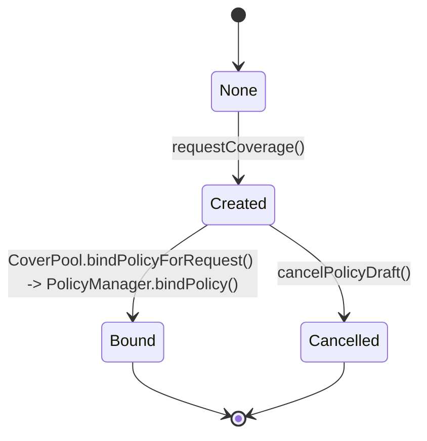

# Policy Lifecycle

## Overview

Policies move through a two-step lifecycle:

1. request stage (`PolicyDraft` created),
2. bind stage (`PolicyMetadata` stored and active for claims).

This split allows stake-backed readiness checks between request and activation.

## Lifecycle States

`PolicyManager.PolicyStatus`:

- `None` - no draft exists.
- `Created` - draft created via `requestCoverage`.
- `Cancelled` - draft cancelled by the requesting covered vault/buyer before binding.
- `Bound` - policy bound and active metadata persisted.

## State Machine

## Phase 1: Request Coverage

Entry: The wrapper owner (EOA/multisig) calls `PolicyManager.requestCoverage(...)` as `msg.sender`; this address is recorded as `buyer`.

Recommended tuple for the `CoveredVaultWrapper` integration:

- `buyer`: wrapper **owner** (EOA/multisig). `CoveredVaultWrapper._validatePolicyBinding` enforces `pol.buyer == owner()` and reverts otherwise.
- `claimer`: `CoveredVaultWrapper` (files claims atomically on withdrawal shortfall),
- `beneficiary`: `CoveredVaultWrapper` (receives payout and tops up user exit),
- `bindPolicyHook`: `CoveredVaultWrapper` (receives `onPolicyBound` callback to store `policyId` and set deposit cap).

Checks:

- pool is factory-registered,
- non-zero beneficiary/claimer/payout token,
- payout token is on the supported whitelist,
- non-zero duration,
- hook address is non-zero and supports `IBindPolicyHook`.

Note: coverage amount (`coverageLimit`) is **not** validated at request time; it appears in the signed quote and is enforced at bind time via `PolicyManager.bindPolicy`.

Effects:

- new `policyId` reserved,
- `PolicyDraft` stored with status `Created`,
- Core committee created with id = `policyId` via `StakeManager.createCommittee(policyId, pool, duration)`.
- Pool curator explicitly added as committee operator via `StakeManager.addOperatorToCommittee(curator, policyId)`.

## Phase 2: Optional Draft Cancellation

Entry: The `buyer` (wrapper owner who called `requestCoverage`) calls `cancelPolicyDraft(policyId)`.

Checks:

- draft exists and is `Created`,
- caller is draft `buyer`.

Effects:

- status becomes `Cancelled`,
- `StakeManager.removeOperatorFromCommittee(curator, policyId)` is called to release the
  committee resources created in Phase 1 — the curator is removed as operator and the committee
  slot is freed in Core,
- no policy metadata is created.

## Phase 3: Bind Policy

Entry: Curator (pool admin) calls `CoverPool.bindPolicyForRequest(...)`.

### 3.1 Quote and Draft Validation (in CoverPool)

- draft exists and belongs to this pool,
- draft status is `Created`,
- quote pool and policy id match draft,
- quote beneficiary matches draft beneficiary,
- quote `expirationTime >= block.timestamp` (enforced by the `validateQuote` modifier in `CoverPool`),
- quote signature valid under `QUOTE_SIGNER_ROLE`.

### 3.2 Core and Spec Registration

- `SpecRegistry.registerSpec(specId, spec)` called by pool. The `ISpec` implementation must be
  pre-approved by the protocol admin via `SpecRegistry.approveSpec(spec)` before this call will
  succeed; an unapproved spec causes the entire bind transaction to revert.
- `StakeManager.setCommitteeVaults(policyId, vaults[], coverageLimit)` binds committee backing vaults and configures TVL limits.

### 3.3 PolicyManager Finalization

`PolicyManager.bindPolicy(...)` validates:

- caller is pool and pool is factory-registered,
- request fields (`buyer`, `beneficiary`, `claimer`, `payoutToken`) match the stored draft,
- `policyId` matches `quote.policyId`,
- committee has at least one vault,
- committee total stake (USD) >= `coverageLimit` (payoutToken-denominated) converted to USD via `OraclePriceFeed.getUSDValue`,
- policy commit is unique.

Note: quote expiry and EIP-712 signature verification are performed exclusively in `CoverPool._verifyQuote`; `PolicyManager.bindPolicy` does not re-verify the signature even though the `BindPolicyRequest` struct carries the `signature` field.

Then it:

- marks draft as `Bound`,
- stores canonical `PolicyMetadata`,
- triggers `IBindPolicyHook.onPolicyBound(policyId, coverageLimit)` (on `CoveredVaultWrapper`: stores `policyId` and configures the deposit cap from `coverageLimit`).

## Phase 4: Active Coverage Window

A bound policy is claimable only during:

- `startTime <= block.timestamp < maturityTime`.

Claims outside this window revert in `ClaimManager`.

## Phase 5: Claim Path

Entry: authorized claimer (typically `CoveredVaultWrapper` acting as claimer) calls `ClaimManager.fileClaim(...)`, triggered atomically on withdrawal-time shortfall detection.

Checks:

- `claimApprovalRequired[policyId] == false` — curator must call `approveNextClaim(policyId)` between any two successive approved claims,
- policy metadata exists,
- `!metadata.premiumDefaulted` — filing is blocked if the policy owner has been flagged for premium default,
- caller equals metadata `claimer`,
- requested amount > 0 and <= remaining coverage,
- evidence hash non-zero and not previously consumed for this policy,
- claim is inside coverage window (`startTime <= now < maturityTime`).

Evaluation and resolution:

- resolve spec by `(pool, specId)`,
- evaluate spec with current context,
- if non-payable → claim rejected,
- if payable → slash and settle payout to configured beneficiary; sets `claimApprovalRequired[policyId] = true` to gate the next claim.

## Invariants

### Identity and Mapping

- `policyId` remains the canonical committee id for all Core interactions.
- one draft -> one bound policy metadata record.

### Economic Bounds

- cumulative payouts per policy cannot exceed `coverageLimit`,
- each claim request is capped by current remaining coverage.

### Determinism

- quote signature domain is pool-specific (`quoteDomainSeparator`),
- policy commits are unique and cannot be re-registered.

## Emergency Exit Path

Users may call `CoveredVaultWrapper.emergencyRedeem` or `emergencyWithdraw` to exit without triggering the insurance claim path. These functions set an in-memory transient flag (`SKIP_INSURANCE_SLOT`) that causes `_computeInsurance` to return 0, bypassing `ClaimManager.fileClaim` even when a shortfall would otherwise exist. The user explicitly waives their insurance entitlement for that exit. This path is intended as an escape hatch when `ClaimManager` is temporarily unavailable or the user chooses to exit at a loss without waiting.

## Operational Checks for Integrators

- Verify pool registration before request.
- Verify stake readiness before bind attempts.
- Ensure vault list is valid and non-empty at bind.
- Ensure bind hook address is ERC165-compatible.
- Ensure swap routes are configured before enabling live claim payouts.
- Ensure the `ISpec` implementation is approved via `SpecRegistry.approveSpec()` before attempting
  policy binding. An unapproved spec causes `bindPolicyForRequest` to revert.
- After each approved claim, the curator must call `ClaimManager.approveNextClaim(policyId)` to clear
  the approval gate before the next claim can be filed.

## Next Steps

- [Restaker Setup and Delegation Lifecycle](./04-restaker-setup.md)
- [Premiums and Claims](./06-premiums-claims.md)
