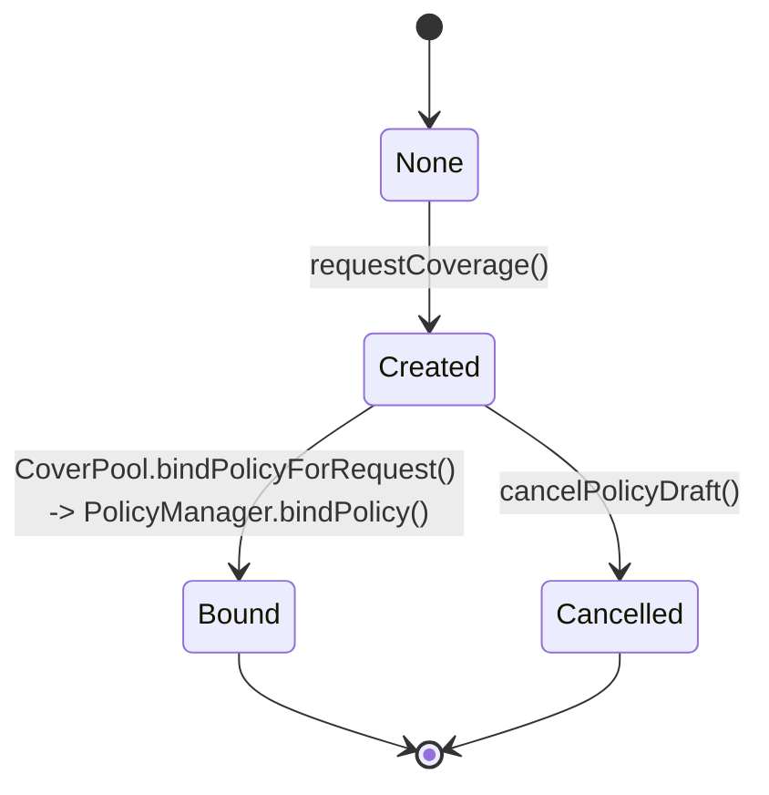

# Policy Lifecycle

## Overview

Policies move through a two-step lifecycle:

1. request stage (`PolicyDraft` created),
2. bind stage (`PolicyMetadata` stored and active for claims).

This split allows stake-backed readiness checks between request and activation.

## Lifecycle States

`PolicyManager.PolicyStatus`:

- `None` - no draft exists.
- `Created` - draft created via `requestCoverage`.
- `Cancelled` - draft cancelled by the requesting covered vault/buyer before binding.
- `Bound` - policy bound and active metadata persisted.

## State Machine

## Phase 1: Request Coverage

Entry: Covered vault (or its adapter, recorded as `buyer`) calls `PolicyManager.requestCoverage(...)`.

Recommended adapter-based tuple:

- `buyer`: covered vault or adapter,
- `claimer`: adapter,
- `beneficiary`: adapter,
- `bindPolicyHook`: adapter (for post-bind cap/config sync).

Checks:

- pool is factory-registered,
- non-zero beneficiary/claimer/payoutToken; payoutToken must be supported,
- non-zero duration,
- hook address supports `IBindPolicyHook`.

Effects:

- new `policyId` reserved,
- `PolicyDraft` stored with status `Created`,
- Core committee created with id = `policyId`;
  `createCommittee` auto-assigns the pool curator as committee operator.

## Phase 2: Optional Draft Cancellation

Entry: The requesting covered vault/buyer calls `cancelPolicyDraft(policyId)`.

Checks:

- draft exists and is `Created`,
- caller is draft buyer (the requesting covered vault/adapter).

Effects:

- status becomes `Cancelled`,
- `StakeManager.removeOperatorFromCommittee(curator, policyId)` is called to release the
  committee resources created in Phase 1 — the curator is removed as operator and the committee
  slot is freed in Core,
- no policy metadata is created.

## Phase 3: Bind Policy

Entry: Curator (pool admin) calls `CoverPool.bindPolicyForRequest(...)`.

### 3.1 Quote and Draft Validation (in CoverPool)

- draft exists and belongs to this pool,
- draft status is `Created`,
- quote pool and policy id match draft,
- quote beneficiary matches draft beneficiary,
- quote timing and expiration valid,
- quote signature valid under `QUOTE_SIGNER_ROLE`.

### 3.2 Core and Spec Registration

- `SpecRegistry.registerSpec(specId, spec)` called by pool.
- `StakeManager.setCommitteeVaults(policyId, vaults[], coverageLimit)` binds committee backing vaults.

### 3.3 PolicyManager Finalization

`PolicyManager.bindPolicy(...)` validates:

- caller is pool and pool is factory-registered,
- request data matches draft values,
- duration matches quote window,
- committee has at least one vault,
   - committee total stake (USD) >= `coverageLimit` (USD) — converted via `getCommitteeTokenStakes` + `ChainlinkPriceFeed.getUSDValue` in `PolicyManager.bindPolicy`,
- policy commit is unique.

Then it:

- marks draft as `Bound`,
- stores canonical `PolicyMetadata`,
- triggers `IBindPolicyHook.onPolicyBound(policyId, coverageLimit)` (typically adapter callback).

## Phase 4: Active Coverage Window

A bound policy is claimable only during:

- `startTime <= block.timestamp <= maturityTime`.

Claims outside this window revert in `ClaimManager`.

## Phase 5: Claim Path

Entry: adapter (as authorized claimer) calls `ClaimManager.fileClaim(...)`, typically on withdrawal-time shortfall detection.

Checks:

- policy metadata exists,
- caller equals metadata `claimer`,
- requested amount > 0 and <= remaining coverage,
- evidence hash non-zero,
- claim is inside coverage window.

Evaluation and resolution:

- resolve spec by `(pool, specId)`,
- evaluate spec with current context,
- if non-payable -> claim rejected,
- if payable -> slash and settle payout to configured beneficiary (typically adapter).

## Invariants

### Identity and Mapping

- `policyId` remains the canonical committee id for all Core interactions.
- one draft -> one bound policy metadata record.

### Economic Bounds

- cumulative payouts per policy cannot exceed `coverageLimit`,
- each claim request is capped by current remaining coverage.

### Determinism

- quote signature domain is pool-specific (`quoteDomainSeparator`),
- policy commits are unique and cannot be re-registered.

## Operational Checks for Integrators

- Verify pool registration before request.
- Verify stake readiness before bind attempts.
- Ensure vault list is valid and non-empty at bind.
- Ensure bind hook address is ERC165-compatible.
- Ensure swap routes are configured before enabling live claim payouts.

## Next Steps

- [Restaker Setup and Delegation Lifecycle](./04-restaker-setup.md)
- [Premiums and Claims](./06-premiums-claims.md)
- [Covered Vault Integration](./07-covered-vault-integration.md)
