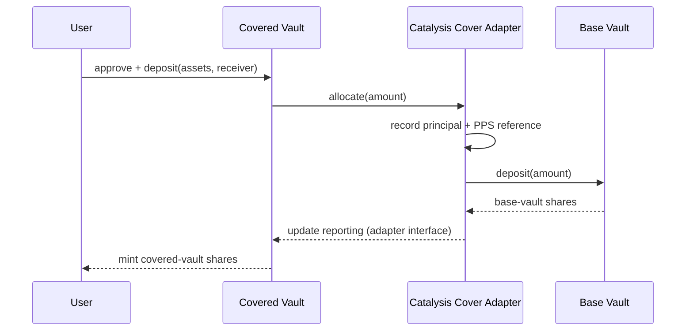
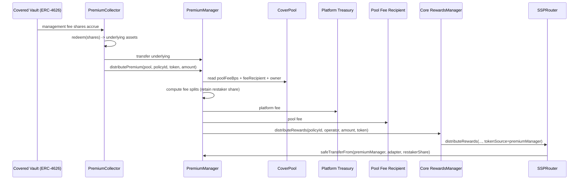
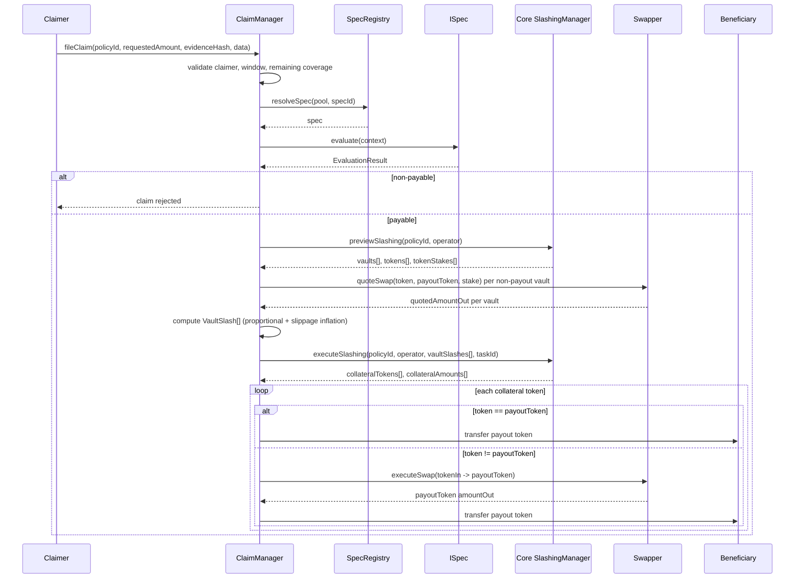
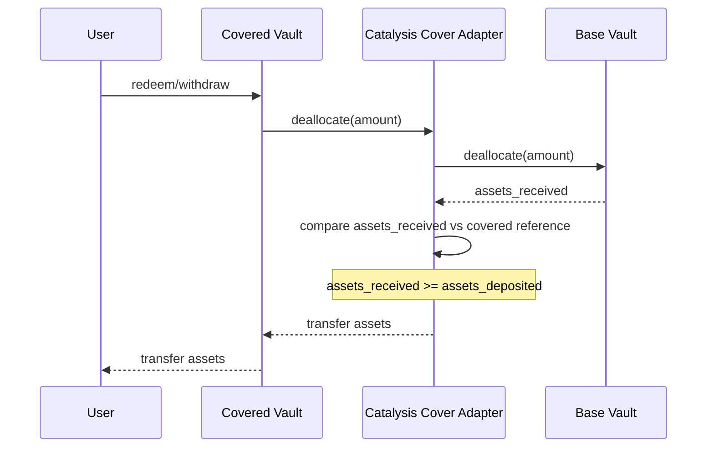
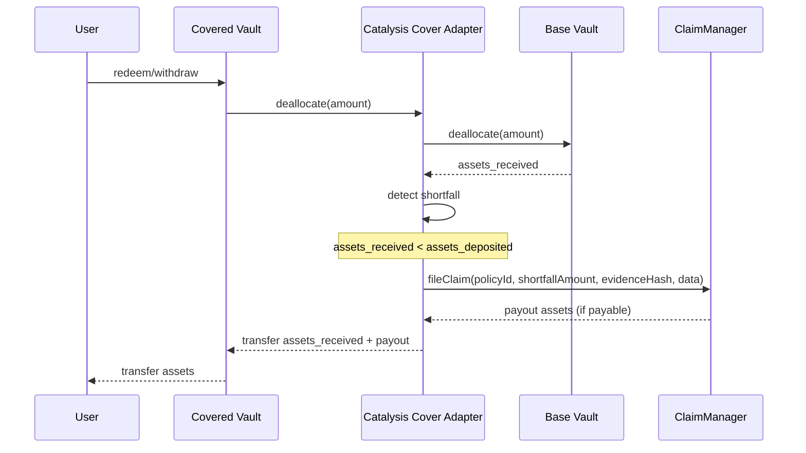

# Premiums and Claims

## Overview

Coverage economics are split into two operational paths:

- **premium path**: covered-vault share accrual -> redemption -> split -> reward routing,
- **claim path**: claim evaluation -> committee slashing -> collateral conversion -> beneficiary payout.

Premiums and claims both use the same policy/committee identity (`policyId`).

Policy actor note:

- In this architecture, the policy `buyer` is expected to be the covered vault or its adapter contract.

## Dual Vault Model Context

The covered integration assumes:

- **Covered Vault (Morpho V2)**: insured user entrypoint.
- **Catalysis Cover Adapter**: allocation/deallocation + shortfall detection + claim trigger.
- **Base Vault (Morpho V1/V2)**: underlying capital destination.

A covered vault maps to one base vault. Users opt into insurance by choosing the covered vault path.

## Deposit Flow (Covered Path)



Adapter accounting details (implementation-specific):

- principal and reference PPS tracking are adapter responsibilities,
- these references are later used to detect withdrawal-time shortfall.

## Premium Flow

### Components

- `PremiumCollector` - collects ERC-4626 shares and redeems to underlying.
- `PremiumManager` - fee splitting and reward routing.
- `CoverPool` - source of pool fee settings and fee recipient.
- Core `RewardsManager` - downstream restaker reward distribution.

### Premium Distribution Sequence



### Fee Split Logic

`PremiumManager.getFeeSplits(grossPremium, platformFeeBps, poolFeeBps)`:

- `platformSplit = gross * platformFeeBps / 10_000`
- `poolSplit = gross * poolFeeBps / 10_000`
- `restakerSplit = gross - platformSplit - poolSplit`

Guardrail:

- `platformFeeBps + poolFeeBps <= 10_000`.

## Claim Flow

### Components

- `ClaimManager` - claim intake, evaluation, and settlement.
- `SpecRegistry` + `ISpec` - payability decision logic.
- Core `SlashingManager` - per-vault stake preview and token-native slashing execution.
- `Swapper` - collateral token conversion and pre-swap quotes for slippage inflation.

### Claim Settlement Sequence



### Withdrawal (No Shortfall / Happy Path)



### Withdrawal (With Shortfall / Claim Path)



Function naming note:

- external docs may refer to `fileAndResolveClaim(...)`,
- current Coverage implementation uses `ClaimManager.fileClaim(...)`, which performs file + resolve atomically.
- for adapter-based make-whole flows, `payoutToken` is typically set to the base-vault underlying token.

## Coverage and Payout Controls

### Remaining Coverage Accounting

For each policy:

- requested claim must be <= current remaining coverage,
- actual payout updates cumulative paid-out amount,
- remaining coverage never drops below zero.

### Claim Window

Claims are accepted only while policy is active:

- `startTime <= now <= maturityTime`.

### Approval Gate

Claim payout path is entered only if `ISpec.evaluate(context).isPayable == true`.

## Collateral Conversion Rules

In `_processCollateral(...)`:

- If collateral already equals payout token:
  - transfer directly up to remaining payout target.
- Else:
  - approve `Swapper`,
  - build `amountOutMin` from live `quoteSwap` quote minus `maxSwapSlippageBps` tolerance (MEV guard);
    falls back to `amountOutMin = 1` if the quote reverts or returns zero,
  - execute configured route,
  - cap delivered amount to remaining payout target,
  - clear approval.

This supports heterogeneous slash collateral while preserving payout-token settlement.

### Two Separate Slippage Controls

| Control | Where | Purpose |
|---------|-------|---------|
| `_inflateForSlippage` | before `executeSlashing` | Inflates the per-vault token-native slash amount proportionally so the beneficiary receives the target payout despite real Uniswap slippage. Uses `Swapper.quoteSwap` → `UniswapV3Adapter.quote` → `QuoterV2`. Capped at `maxSwapSlippageBps` above the base slash. |
| `maxSwapSlippageBps` | inside `_processCollateral` | Applied as a tolerance around a live `quoteSwap` quote to set `amountOutMin` on `executeSwap` — protection against MEV / sandwich attacks between quote and execution. Configurable by admin. Falls back to `amountOutMin = 1` if the quote reverts or returns zero. |

If the slippage preview fails (e.g. `quoteSwap` reverts, route not configured), inflation falls
back to the base slash amount. If `quoteSwap` fails during `_processCollateral`, `amountOutMin`
falls back to 1 (the swap itself reverts on zero output).

## Swapper Configuration for Cross-Token Payouts

When the vault collateral token differs from the policy `payoutToken`, a swap route must be
configured in the `Swapper` before any claim can be paid out. The `UniswapV3Adapter` bridges
the Swapper's static-calldata model to Uniswap V3.

**One-time setup per `(tokenIn, tokenOut)` pair:**

```bash
forge script script/DeployUniswapV3Adapter.s.sol \
  --rpc-url $RPC_URL --broadcast --slow -vvvv
```

Required env vars:

| Variable | Description |
|----------|-------------|
| `PRIVATE_KEY` | Admin key holding `SWAP_MANAGER_ROLE` on Swapper |
| `SWAPPER` | Swapper proxy address (from `ClaimManager.swapper()`) |
| `SWAP_ROUTER` | Uniswap V3 SwapRouter02 (Sepolia: `0x3bFA4769FB09eefC5a80d6E87c3B9C650f7Ae48E`) |
| `TOKEN_IN` | Collateral token (e.g. Uniswap-native WETH on Sepolia: `0xfff9976782d46cc05630d1f6ebab18b2324d6b14`) |
| `TOKEN_OUT` | Payout token (e.g. Circle Sepolia USDC: `0x1c7D4B196Cb0C7B01d743Fbc6116a902379C7238`) |
| `POOL_FEE` | Uniswap V3 fee tier (e.g. `3000` = 0.3%, `500` = 0.05%) |

The script deploys the adapter, whitelists it in Swapper, and registers the route in a single
transaction.

**Verify before filing a claim:**

`FileClaim.s.sol` Phase 2 (Swapper Readiness) automatically checks each committee vault's
collateral token against the policy payout token and validates that a route is configured and the
target is whitelisted. It reverts before broadcasting if any route is missing.

## Risk and Operations

### Configuration Risks

- Missing or bad swap routes can impair payout conversion for non-payout collateral.
- Incorrect fee settings can over-route or under-route premium shares.
- Wrong vault registration in `PremiumCollector` can mis-route policy rewards.

### Runtime Risks

- If Core slashing preview returns zero total stake, payout path reverts (`NoCollateralSlashed`).
- If Core slashing execution returns no collateral, payout path reverts.
- Claim timing outside coverage window always reverts.

### Operational Controls

- Keep claim swap routes and whitelisted targets maintained ahead of incidents.
- Monitor `PremiumDistributed`, `ClaimFiled`, `ClaimApproved`, `ClaimRejected`, `CollateralSwapped`.
- Validate policy-to-vault mappings before policy activation.

## Migration Flow (Base Vault -> Covered Vault)

For existing base-vault users opting into insurance:

1. User calls a migrator contract.
2. Migrator redeems user position from base vault to underlying asset.
3. Migrator deposits underlying into covered vault on behalf of user.
4. Covered vault mints covered shares to user.

This migration is an integration-layer flow and usually implemented outside Coverage core contracts.

## Practical Testing Coverage

The scripts in `script/testing/` map directly to this document:

- `DistributePremium.s.sol` validates premium distribution path.
- `FileClaim.s.sol` validates claim evaluation and payout path.
- `CompleteCoverageFlow.s.sol` exercises both paths in sequence.

## Next Steps

- [Covered Vault Integration](./07-covered-vault-integration.md)
- [System Overview](./01-system-overview.md)
- [Policy Lifecycle](./05-policy-lifecycle.md)
