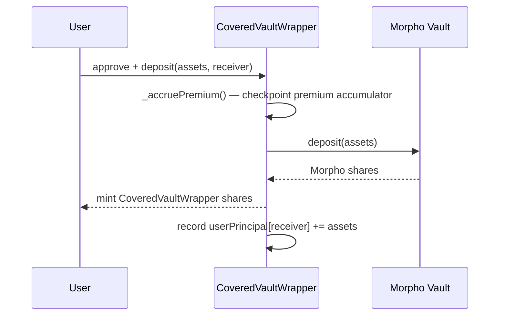
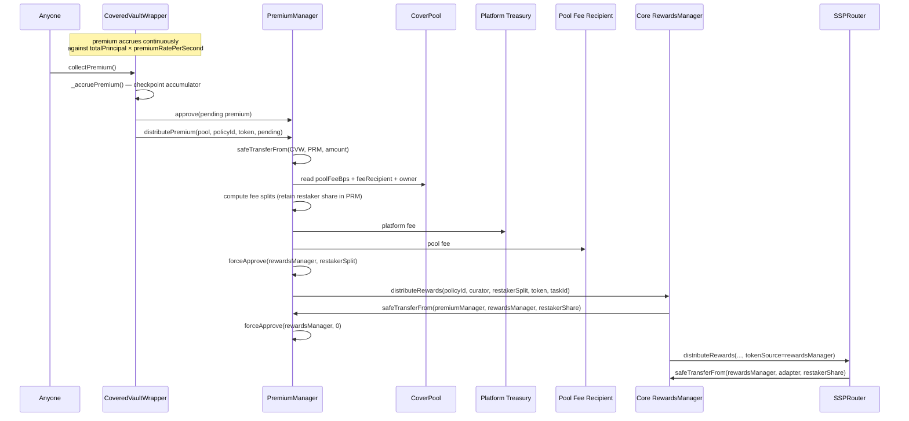
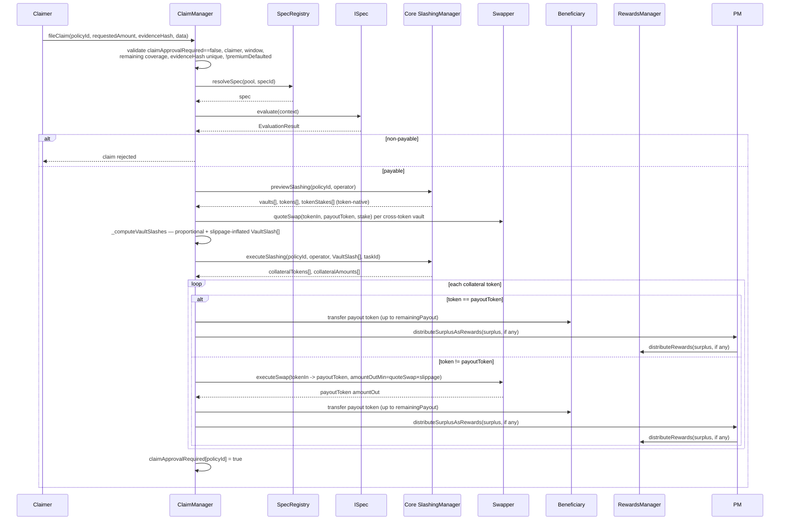
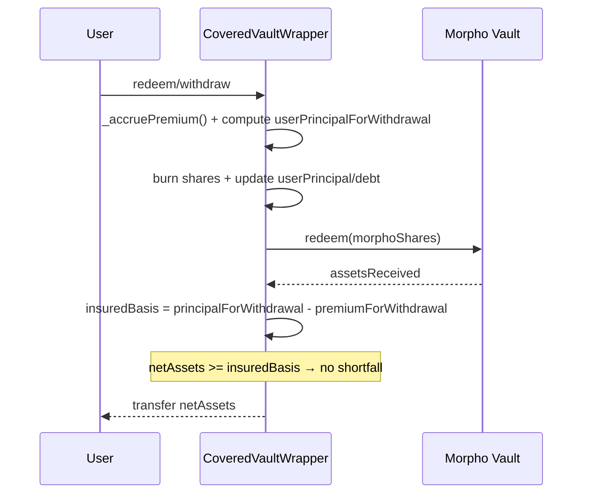
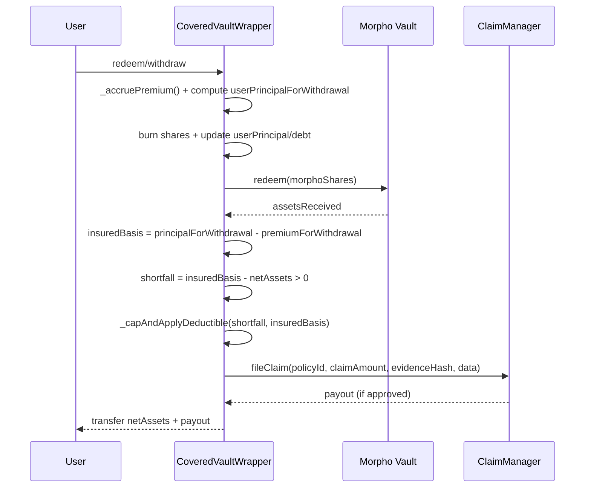

# Premiums and Claims

## Overview

Coverage economics are split into two operational paths:

- **premium path**: continuous accrual in `CoveredVaultWrapper` against depositor principal → `collectPremium()` flush → fee split in `PremiumManager` → restaker reward routing,
- **claim path**: withdrawal-time shortfall detection → `fileClaim` evaluation → token-native committee slashing → collateral conversion → beneficiary payout.

Premiums and claims both use the same policy/committee identity (`policyId`).

Policy actor note:

- In this architecture, the policy `buyer` is the wrapper **owner** (EOA or multisig) — the `msg.sender` of `PolicyManager.requestCoverage`. The `CoveredVaultWrapper` contract itself is the `claimer` and `beneficiary`, but **not** the `buyer`. `CoveredVaultWrapper._validatePolicyBinding` enforces `pol.buyer == owner()` and reverts if it does not match.

## CoveredVaultWrapper Integration Context

The covered integration uses a single `CoveredVaultWrapper`:

- **CoveredVaultWrapper**: UUPS-upgradeable ERC-4626 vault that wraps a Morpho V2 vault; user-facing and premium-bearing.
- **Morpho Vault (underlying)**: yield source; wrapper is its sole depositor.

Users opt into insurance by depositing into the `CoveredVaultWrapper` rather than directly into the Morpho vault.

## Deposit Flow (Covered Path)



Accounting details:

- `userPrincipal[receiver]` tracks cost-basis (not yield); premium accrues on principal only,
- a per-user `userPremiumDebt` offset prevents the depositor from inheriting liability that accrued before they arrived.

## Premium Flow

### Components

- `CoveredVaultWrapper` - accrues premiums internally; exposes `collectPremium()` as a permissionless flush. When `policyId != 0` (normal bound policy path), it approves `PremiumManager` and calls `distributePremium`. When `policyId == 0` (e.g. after `resetPolicyBinding()`), it falls back to a direct `safeTransfer` to `premiumRecipient`. In practice, premium cannot accrue without a bound policy, so the fallback path is a defensive belt-and-suspenders guard.
- `PremiumManager` - fee splitting and reward routing.
- `CoverPool` - source of pool fee settings and fee recipient.
- Core `RewardsManager` - downstream restaker reward distribution.

### Premium Distribution Sequence



### Fee Split Logic

`PremiumManager.getFeeSplits(grossPremium, platformFeeBps, poolFeeBps)`:

- `platformSplit = gross * platformFeeBps / 10_000`
- `poolSplit = gross * poolFeeBps / 10_000`
- `restakerSplit = gross - platformSplit - poolSplit`

Guardrails:

- `platformFeeBps <= 2_500` (25% max for platform fee),
- `platformFeeBps + poolFeeBps <= 5_000` (combined fee cap of 50%).

## Claim Flow

### Components

- `ClaimManager` - claim intake, evaluation, and settlement.
- `SpecRegistry` + `ISpec` - payability decision logic. Only admin-approved `ISpec` implementations
  can be registered. Resolution via `resolveSpec` is also gated by approval — if a spec is revoked,
  claim resolution for any `(pool, specId)` pair using that address is blocked until the spec is re-approved.
- Core `SlashingManager` - committee slashing execution (token-native amounts, no USD conversion).
- `Swapper` + `quoteSwap` - collateral token conversion and slippage-adjusted minimum output.

### Claim Settlement Sequence



### Withdrawal (No Shortfall / Happy Path)



### Withdrawal (With Shortfall / Claim Path)



Note: `ClaimManager.fileClaim(...)` performs file + resolve atomically. `payoutToken` is set to the Morpho vault's underlying token. Share burning and principal/debt updates happen **before** the Morpho redeem call in `_executeWithdrawal`.

### Emergency Exit (Insurance Waived)

Users may call `emergencyRedeem` or `emergencyWithdraw` to exit without triggering the claim path. A transient flag (`SKIP_INSURANCE_SLOT`) causes `_computeInsurance` to return 0, bypassing `ClaimManager.fileClaim` even when a shortfall exists. The user explicitly waives insurance for that exit and receives only the Morpho vault proceeds.

## Coverage and Payout Controls

### Remaining Coverage Accounting

For each policy:

- requested claim must be <= current remaining coverage,
- actual payout updates cumulative paid-out amount,
- remaining coverage never drops below zero.

### Claim Window

Claims are accepted only while policy is active:

- `startTime <= now < maturityTime`.

### Spec Approval Gate

Claim payout path is entered only if `ISpec.evaluate(context).isPayable == true`.

### Curator Approval Gate (per successive claim)

After each approved claim, `claimApprovalRequired[policyId]` is set to `true`. The policy curator must call `ClaimManager.approveNextClaim(policyId)` before the next `fileClaim` will be accepted. This gives the curator a mandatory review window between successive payouts.

### Premium Default Gate

`fileClaim` checks `!metadata.premiumDefaulted`. If the admin has flagged the policy as premium-defaulted (via `PolicyManager`), claims are rejected until the default is cleared.

### Evidence Hash

Every call to `fileClaim` must supply a non-zero `evidenceHash` that is unique per policy. The
`ClaimManager` maintains a per-policy set of consumed hashes and reverts with `DuplicateEvidenceHash`
if the same hash is reused, whether the original claim was approved or rejected. This ensures each
claim references distinct evidence and supports post-claim auditing.

Callers should supply a hash that identifies a retrievable evidence document, such as an IPFS CID
digest (`keccak256` of the CID multihash bytes), to enable off-chain verification.

## Collateral Conversion Rules

In `_processCollateral(...)`:

- If collateral already equals payout token:
  - transfer directly up to `remainingPayout`; any surplus is forwarded to `RewardsManager` via `PremiumManager.distributeSurplusAsRewards` (skipped for native ETH surplus or if `premiumManager` is unset).
- Else (cross-token):
  - `_computeAmountOutMin` calls `Swapper.quoteSwap(tokenIn, tokenOut, amountIn)` and applies `maxSwapSlippageBps` to get a slippage-adjusted minimum output,
  - approve `Swapper` for `collateralAmount`,
  - call `Swapper.executeSwap(params)` with the computed `amountOutMin`,
  - cap delivered amount to `remainingPayout`; any surplus swap output is forwarded to `RewardsManager` via `PremiumManager.distributeSurplusAsRewards` (skipped for native ETH payout or if `premiumManager` is unset),
  - clear residual approval.

Surplus distribution is wrapped in a `try`/`catch`. If it fails, a `SwapSurplusDistributionFailed` event is emitted and the surplus tokens remain in `ClaimManager` for recovery via `recoverTokens`.

The `CollateralSwapped` event is emitted for **every** processed collateral leg, including same-token direct transfers — not only for cross-token swaps. Monitor it to track all claim settlement activity.

Vault slashes are pre-inflated in `_computeVaultSlashes` (by `1 / (1 - maxSwapSlippageBps)` for cross-token vaults) so that worst-case slippage still yields the full `requestedAmount` to the beneficiary.

This supports heterogeneous slash collateral while preserving payout-token settlement without relying on an oracle.

## Bind-Time Route Validation and Active-Policy Route Lock (CYS3-06)

### Invariant

`PolicyManager.bindPolicy` enforces that **every non-payout collateral token** backing a policy
has an enabled, non-zero `Swapper` quote route to the policy `payoutToken` at bind time. This
check runs before the USD-value sufficiency check so that collateral without a settlement path
can never count toward coverage backing.

### How it works

1. `PolicyManager.bindPolicy` calls `IClaimManager.validateAndLockCollateralRoutes(policyId, payoutToken, maturityTime, tokens, tokenStakes)` once per policy, immediately after fetching committee token stakes.
2. `ClaimManager.validateAndLockCollateralRoutes` (only callable by `policyManager`) iterates the token array:
   - Tokens that equal `payoutToken` or have zero stake are skipped (no route needed).
   - For each remaining token: `Swapper.quoteSwap(token, payoutToken, stake)` must return a non-zero value; any zero return or revert causes an immediate `MissingSwapRouteForCollateral` revert.
   - After passing the quote check, `Swapper.lockRouteUntil(token, payoutToken, maturityTime)` locks the route.
3. `Swapper.lockRouteUntil` (only callable by `claimManager`) records the lock monotonically for both the `(tokenIn, tokenOut)` route key and the current swap target. The lock timestamp only moves forward — a later policy binding can extend a lock but never shorten it.

### Lock enforcement

While a route lock is active (`block.timestamp < lockedUntil`):

- `Swapper.setSwapRoute` rejects any **material** change: disabling the route or replacing its swap target reverts with `RouteLockedByActivePolicies`. Updating only `swapCalldata` (same target, same `enabled = true`) is still permitted so admins can patch DEX-side calldata.
- `Swapper.setSwapTargetWhitelist(target, false)` reverts with `TargetLockedByActivePolicies` while the target lock is active.

Locks expire at `maturityTime`. Once the last dependent policy matures, swap managers can freely modify or disable the route.

### Wiring requirement

`Swapper.setClaimManager(claimManager)` must be called as part of the cross-system wiring
(step 9 in `WireCoreContracts.s.sol`) before any policy is bound. Without this, `lockRouteUntil`
will revert with `OnlyClaimManager` during the first `bindPolicy` call.

---

## Swapper Configuration for Cross-Token Payouts

When the vault collateral token differs from the policy `payoutToken`, a swap route must be
configured in the `Swapper` before any claim can be paid out. The `UniswapV3Adapter` bridges
the Swapper's static-calldata model to Uniswap V3.

**One-time setup per `(tokenIn, tokenOut)` pair:**

```bash
forge script script/DeployUniswapV3Adapter.s.sol \
  --rpc-url $RPC_URL --broadcast --slow -vvvv
```

Required env vars:

| Variable | Description |
|----------|-------------|
| `PRIVATE_KEY` | Admin key holding `SWAP_MANAGER_ROLE` on Swapper |
| `SWAPPER` | Swapper proxy address (from `ClaimManager.swapper()`) |
| `SWAP_ROUTER` | Uniswap V3 SwapRouter02 (Sepolia: `0x3bFA4769FB09eefC5a80d6E87c3B9C650f7Ae48E`) |
| `TOKEN_IN` | Collateral token (e.g. Uniswap-native WETH on Sepolia: `0xfff9976782d46cc05630d1f6ebab18b2324d6b14`) |
| `TOKEN_OUT` | Payout token (e.g. Circle Sepolia USDC: `0x1c7D4B196Cb0C7B01d743Fbc6116a902379C7238`) |
| `POOL_FEE` | Uniswap V3 fee tier (e.g. `3000` = 0.3%, `500` = 0.05%) |

The script deploys the adapter, whitelists it in Swapper, and registers the route in a single
transaction.

**Verify before filing a claim:**

`FileClaim.s.sol` Phase 2 (Swapper Readiness) automatically checks each committee vault's
collateral token against the policy payout token and validates that a route is configured and the
target is whitelisted. It reverts before broadcasting if any route is missing.

## Risk and Operations

### Configuration Risks

- Missing or bad swap routes can impair payout conversion for non-payout collateral.
- Incorrect fee settings can over-route or under-route premium shares.
- Wrong `pool`/`policyId` passed to `distributePremium` can mis-route policy rewards.

### Runtime Risks

- If Core slashing returns no collateral, payout path reverts.
- If `Swapper.quoteSwap` reverts or returns zero for a cross-token vault, or if the computed proportional slash rounds to zero after slippage inflation, that vault is excluded from slashing (`VaultExcludedFromSlashing` event emitted).
- Claim timing outside coverage window always reverts.

### Operational Controls

- Keep claim swap routes and whitelisted targets maintained ahead of incidents.
- Monitor `PremiumDistributed`, `ClaimFiled`, `ClaimApproved`, `ClaimRejected`, `CollateralSwapped` (fires for every collateral leg, including same-token transfers), `VaultExcludedFromSlashing`, `SwapSurplusDistributionFailed`.
- Validate policy-to-vault mappings before policy activation.

## Migration Flow (Base Vault -> Covered Vault)

For existing base-vault users opting into insurance:

1. User calls a migrator contract.
2. Migrator redeems user position from base vault to underlying asset.
3. Migrator deposits underlying into covered vault on behalf of user.
4. Covered vault mints covered shares to user.

This migration is an integration-layer flow and usually implemented outside Coverage core contracts.

## Practical Testing Coverage

The scripts in `script/testing/` map directly to this document:

- `DistributePremium.s.sol` — calls `CoveredVaultWrapper.collectPremium()`, validating the premium flush and distribution path.
- `FileClaim.s.sol` — phases: prerequisites → Swapper readiness → pre-claim snapshot → file → result; validates claim evaluation and payout path including swap metrics.
- `CompleteCoverageFlow.s.sol` — exercises both paths end-to-end; includes lightweight Swapper readiness logging and skip-if-zero-amount guards for re-runs.

## Next Steps

- [System Overview](./01-system-overview.md)
- [Policy Lifecycle](./05-policy-lifecycle.md)
- [CoveredVaultWrapper Accounting](./07-covered-vault-accounting.md)
